<p align="center">
  <a href="README.md">🇫🇷 Français</a> · <b>🇬🇧 English</b>
</p>

<h1 align="center">🍳 Frameo Kitchen Dashboard</h1>

<p align="center">
  <b>A €130 Frameo photo frame, turned into a kitchen dashboard for Home Assistant</b><br>
  <sub>Meals and step-by-step recipes · shopping list · family calendar · weather and pollen · house · car · air conditioning · kids' routines · photos</sub><br><br>
  🙏 Inspired by <a href="https://github.com/wesbos/photo-frame-dashboard"><b>photo-frame-dashboard</b></a> by <a href="https://github.com/wesbos"><b>Wes Bos</b></a>
</p>

<p align="center">
  <a href="#demo"><b>Demo</b></a> ·
  <a href="#install"><b>Install</b></a> ·
  <a href="#documentation"><b>Documentation</b></a> ·
  <a href="#disclaimer"><b>Disclaimer</b></a>
</p>

<p align="center">
  
  
  
  <br>
  
  
  
  
  
</p>

<p align="center">
  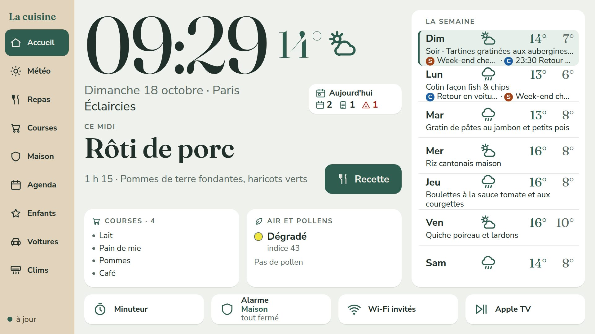
</p>

> [!NOTE]
> **Thanks to Wes Bos.** It all started with his video about hacking a $50 photo frame and his repository
> [**wesbos/photo-frame-dashboard**](https://github.com/wesbos/photo-frame-dashboard): the idea, the method (ADB, a
> WebView kiosk app) and the careful approach (verified backup before any write). The code here was written from scratch
> for another frame and another home, but this project would not exist without his work. Go check his out!

> [!WARNING]
> **Personal project, shared as is, with no warranty whatsoever.** It was built for MY home: yours will need changes.
> It touches sensitive things (ADB and the launcher of a device, Home Assistant, alarm, car, air conditioners). **You use
> it at your own risk**: I am not responsible for a bricked frame, a voided warranty, an air conditioner or a car driven
> the wrong way, a poorly protected home, or anything else.
> Details: [Disclaimer and liability](#disclaimer).

> [!CAUTION]
> **Never expose this server to the Internet.** It is designed for the local network only. All writes (shopping list,
> remotes, car, air conditioners) are **disabled by default**: only enable them one at a time, knowing what you are doing.

> [!TIP]
> **The dashboard's interface is in French and runs on Paris time** (dates, Tempo, timers). The code, its comments and
> the docs in `docs/` are in French too. Environment variables, files and API routes keep their French names
> (`LIEU_NOM` = place name, `ACTIONS_REELLES` = real actions, `serveur/` = server...): this README gives the meaning of
> each one.

---

## 💡 The idea

A 15.6" Frameo photo frame (Rockchip RK3326 chip, Android 9) recycled as a kitchen screen. A small **kiosk** app shows,
full screen, a web page served by a **backend** on the home server. That backend is the only one talking
to **Home Assistant** and **Immich**: the frame knows no token, no password, no internal address.

Everything is designed to be read from 2 meters away, touched with wet fingers, and understood by a 3-year-old.

> [!IMPORTANT]
> **Three names show up everywhere, in the docs and in the code**, because the project was written for one specific
> home:
> - **M900**: the **home server**, a second-hand Lenovo ThinkCentre M900 Tiny (an office mini PC) recycled as a Debian
>   server. It runs Home Assistant, Immich and this project in Docker. At your place, any always-on Linux machine will
>   do ([Hardware](#hardware)).
> - **Clevo**: the **admin PC**, a Linux laptop used to develop, connect the frame over USB and run the tools. Its
>   device key opens a few restricted routes (`/api/etat`).
> - **Mur** ("wall"): the frame's **Home Assistant user**, without admin rights.
>
> Dates in the comments ("choice of 14/10") refer to the design log [docs/conception.md](docs/conception.md).

## 🖼️ The screens

<table>
  <tr>
    <td width="50%">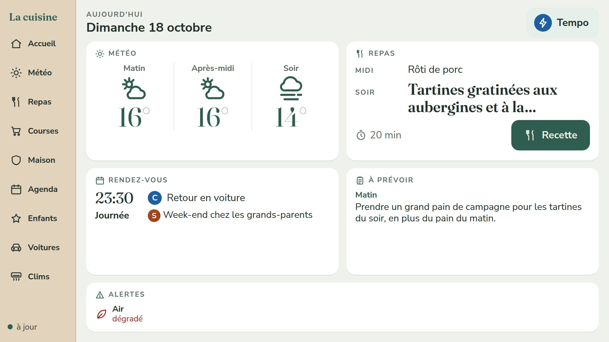<br><b>Today</b> · weather by time of day, lunchbox and dinner, appointments, reminders</td>
    <td width="50%">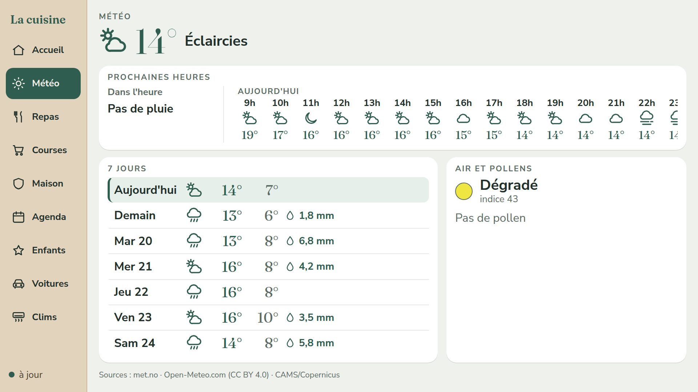<br><b>Weather</b> · hour by hour, 7 days, rain in the next hour, air quality and pollen</td>
  </tr>
  <tr>
    <td>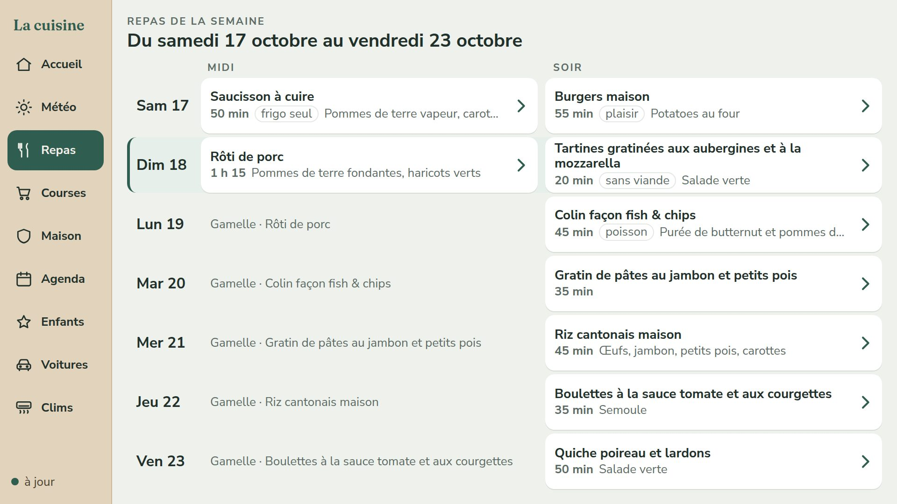<br><b>Meals</b> · the week's menu, each dish opens its step-by-step recipe with timers</td>
    <td>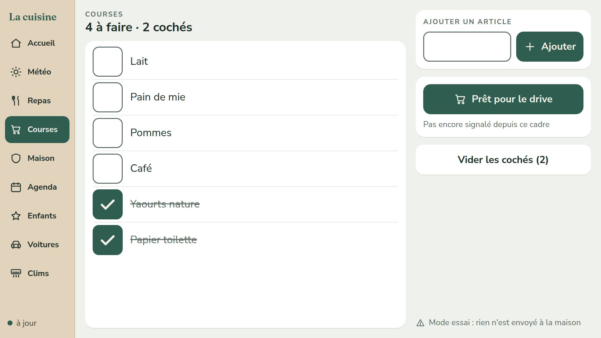<br><b>Shopping</b> · the shared Home Assistant list, checked off with a fingertip</td>
  </tr>
  <tr>
    <td>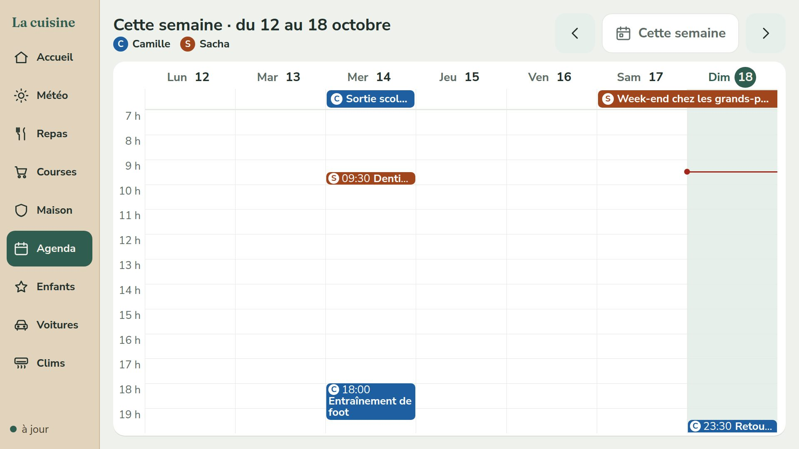<br><b>Calendar</b> · a single family calendar as a week grid, one color per person</td>
    <td>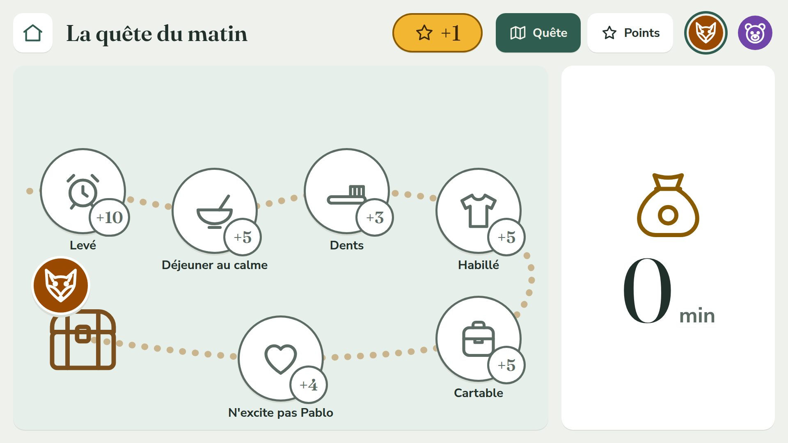<br><b>Kids</b> · the morning quest: each step earns screen minutes, points to spend in a shop</td>
  </tr>
  <tr>
    <td>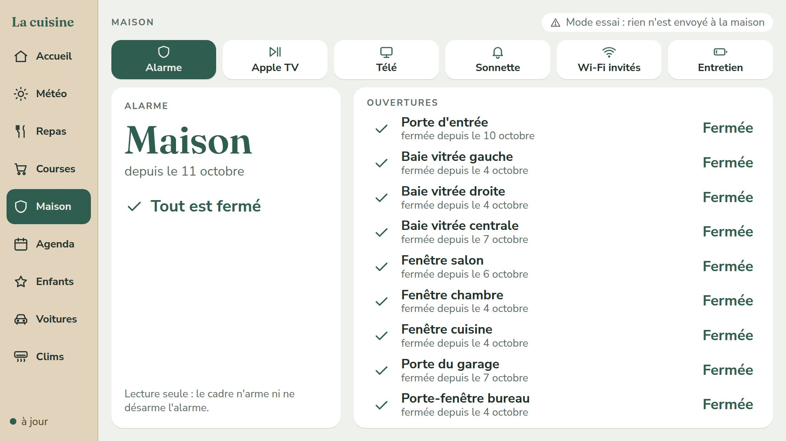<br><b>House</b> · alarm and openings, read only; doorbell with photo and live view; guest Wi-Fi as a QR code</td>
    <td>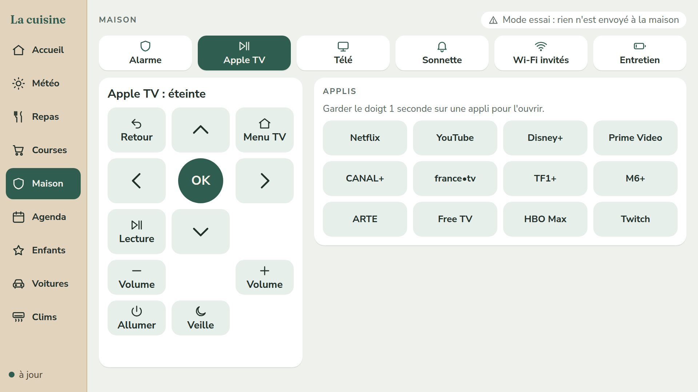<br><b>Remotes</b> · Apple TV and TV, apps on long press so the kids don't stop the movie</td>
  </tr>
  <tr>
    <td>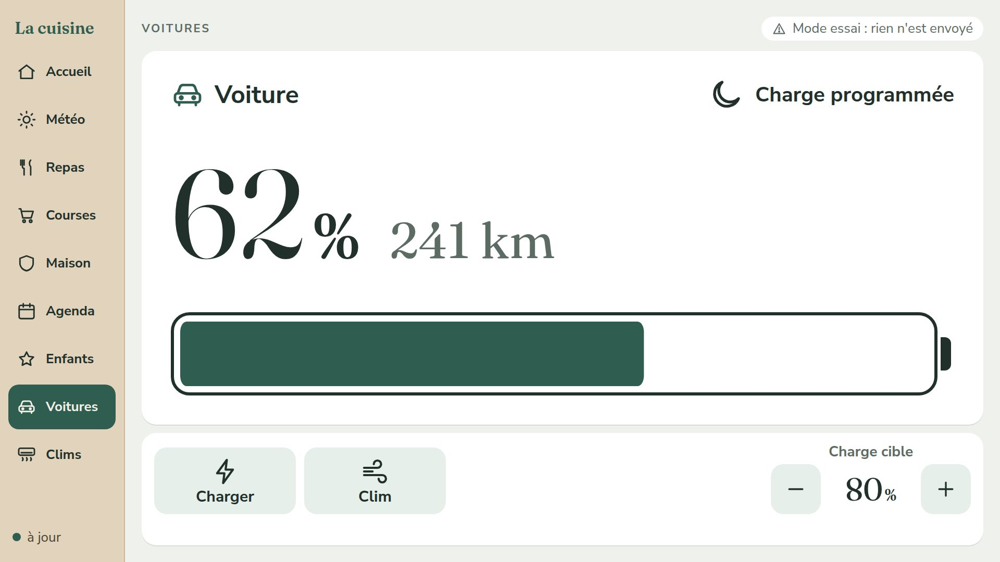<br><b>Cars</b> · battery and range, charging, climate, lights, horn, charge levels</td>
    <td>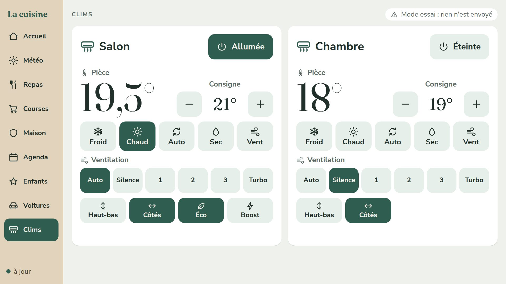<br><b>Air conditioning</b> · two units, fully controlled: power, mode, setpoint, fan, swing, options</td>
  </tr>
</table>

Also: **Photos mode** (Immich slideshow after 3 minutes without a touch), **EDF Tempo** (French electricity tariff: color of
today and tomorrow, warning the day before a red day), **bed sheets** to change, **day, evening and night themes**
following the sun, a **doorbell banner** above any screen.

## 🧱 How it is built

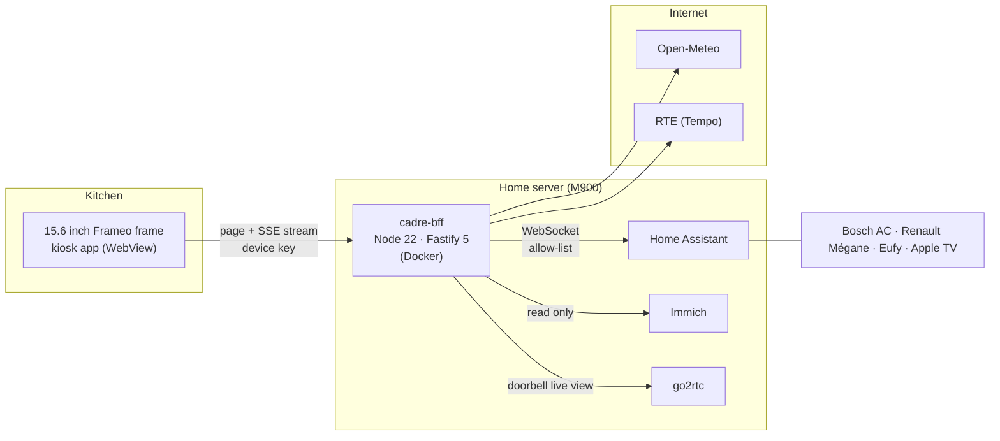

| Part | Role |
|---|---|
| `kiosque/` | home-made Android app: full-screen WebView, launcher, brightness, Wi-Fi watchdog |
| `serveur/` | the backend: entity allow-list, SSE stream to the page, actions behind safeguards |
| `web/` | the page: native ES modules without a bundler (ES2019 to be safe), CSS grids, icon sprite |
| `deploiement/` | `deployer.sh` (tests, upload, Docker build on the server, health check) and `docker-compose.yml` |
| `tests/` | 64 `node --test` files, home-made fake DOM, WCAG contrast computed from the stylesheets |

## 🔒 Security first

- **The frame holds no secret**: one revocable device key, and the backend talks to Home Assistant with a non-admin
  user.
- **Allow-lists everywhere**: only named entities are read, never the car's location or mileage, never the alarm in
  write mode (the frame neither arms nor disarms).
- **Four separate write safeguards**, simulated by default ("Mode essai", trial mode, on screen): `ACTIONS_REELLES`
  (shopping list), `ACTIONS_MAISON` (remotes, doorbell), `ACTIONS_VOITURE` (car), `ACTIONS_CLIM` (air conditioners).
  None opens the others, and the Home Assistant connection checks each one again as a last lock.
- **Rate limiting** on commands that go through a cloud (Renault API quota, Bosch cloud).

<a name="demo"></a>

## 🧪 Try it without a smart home (demo)

```bash
npm ci
npm run demo
```

Then open in Chrome the `http://127.0.0.1:8020/dev/appairer?code=...` address printed in the log, with a 1920 x 1080
window. The real server runs on a **fake Home Assistant** (`HA_DEMO=1`) and a fake Immich, with sample data shifted to
the current week; the weather is Paris's (Open-Meteo, if the Internet answers). Everything is in trial mode: the demo
cannot write anything. The screenshots in this README come from it.

<a name="hardware"></a>

## 🧰 Hardware

| What | What works | The original one |
|---|---|---|
| **The frame** | An **Android** photo frame where **ADB** can be enabled (many Frameo frames: Settings, About, beta program). Android 7 or later, WebView 64 or later, a touch screen. The same product name does not mean the same board: **check yours before mounting it**, with [docs/jour-j.md](docs/jour-j.md). | 15.6" Frameo "AVE-V5 Max" (Rockchip RK3326, Android 9, 2 GB), about €130: [sheet](docs/cadre-ave948.md) |
| **The home server** | Any always-on Linux machine with **Docker**: a second-hand mini PC (Lenovo Tiny, Dell Micro, HP Mini, NUC), an old laptop, a Raspberry Pi 4 or 5. The frame's backend itself is light (256 MB of memory at most). | Second-hand Lenovo ThinkCentre M900 Tiny, on Debian |
| **Home Assistant** | A working installation, on the same server or elsewhere (HA OS on a Pi, HA Green...). | In Docker on the M900 |
| **A PC** | Linux or macOS with Node 22, to develop, build the app and connect the frame over USB. | Clevo laptop on Kubuntu |
| **Optional** | Immich (photos), go2rtc (doorbell live view), Renault and Bosch HomeCom integrations (car, air conditioners): each screen says "not linked yet" as long as its variable is empty. | All of it |

<a name="install"></a>

## 🏠 Install it at home

> [!NOTE]
> Count one evening for the server and another for the frame. Want to look first? `npm run demo` is enough
> ([Demo](#demo)).

**On your PC you need**: `git`, Node 22, `adb` (the `adb` package or Android platform-tools), `ssh`, `rsync`, `curl`,
Python 3 and Chrome; for the kiosk app, JDK 17, `zip` and the Android SDK (build-tools 34.0.0 and platform android-34,
no Gradle). **On the server**: Docker with Compose v2 usable without `sudo` (`docker` group), `rsync` and SSH access with
a key.

1. **Get the project** (a real git clone: the deployment script refuses a ZIP archive).

   ```bash
   git clone https://github.com/thomasarronis-hash/frameo-kitchen-dashboard.git
   cd frameo-kitchen-dashboard
   npm ci
   npm test
   ```

2. **Check your frame** before keeping it: [docs/jour-j.md](docs/jour-j.md) (in French), with
   `outils/identifier-cadre.sh` (read only) and `web/compat/compat.html`. If the frame does not fit, there is still
   time to return it.

3. **Create the frame's Home Assistant user.** In HA: Settings, People, Add person (here "Mur"), allow login, do
   **not** make it an administrator, and enable the option that restricts login to the local network. Then log in to
   HA with that account, open its profile, Security tab, and create a **long-lived access token**.

4. **Run in development on your PC.** The device key and the token are files, never values in the code:

   ```bash
   mkdir -p ~/.config/cadre
   (umask 077 && node -e "process.stdout.write(require('node:crypto').randomBytes(32).toString('hex'))" > ~/.config/cadre/cle_dev)
   (umask 077 && read -rsp "HA token: " T && printf %s "$T" > ~/.config/cadre/ha_token_dev)
   cp .env.example .env
   ```

   In `.env`, fill in at least `HA_URL` (for example `http://192.168.1.50:8123`) and the weather location
   (`LIEU_NOM`, `LIEU_LATITUDE`, `LIEU_LONGITUDE`). Then:

   ```bash
   npm run verif-ha
   PORT=8027 npm run dev
   ```

   `verif-ha` (read only) refuses an admin token and lists the expected entities missing at your place. Open in Chrome
   the pairing address printed in the log (`/dev/appairer?code=...`), with a 1920 x 1080 window. Port 8027 is just an
   example: any free port works, 8020 being the production one.

5. **Adapt it to your home**: entity names (alarm, openings, remotes, doorbell...), screens to hide, the kids. This is
   the longest step: [Adapting it to your home](#adapt).

6. **Prepare the server and deploy**: [Deploying](#deploying). **The server stays on the local network**: never open
   its port to the Internet or to a shared network.

7. **Install the app on the frame**: [Installing the kiosk](#kiosk).

8. **The week's menu**: a JSON file to write or generate, then publish to the server ([The week's menu](#menu)).

All write safeguards are **disabled by default**: as long as you don't set `ACTIONS_*=1`, nothing is sent to the
house, and the screen says so (trial mode).

---

<a name="documentation"></a>

<h1 align="center">Technical documentation</h1>

<details open>
<summary><b>Contents</b></summary>

1. [What runs at our place](#at-home)
2. [Architecture](#architecture)
3. [Configuration](#configuration)
4. [Writes and safeguards](#writes-and-safeguards)
5. [API routes](#api-routes)
6. [Screens](#screens) · [Home and Today](#home-and-today) · [Weather](#weather) · [Meals](#meals) · [Shopping](#shopping) · [Calendar](#calendar) · [House](#house) · [Photos](#photos) · [EDF Tempo](#edf-tempo) · [Cars](#cars) · [Air conditioners](#air-conditioners) · [Kids board](#kids-board)
7. [Adapting it to your home](#adapt)
8. [The week's menu](#menu)
9. [Development](#development)
10. [Deploying to the home server](#deploying)
11. [The frame and the kiosk](#kiosk)
12. [Repository rules](#repository-rules)
13. [Disclaimer and liability](#disclaimer)
14. [License and credits](#license)

</details>

Identifying your frame: [docs/jour-j.md](docs/jour-j.md). Recovery when something goes wrong:
[docs/recuperation.md](docs/recuperation.md). Original frame sheet: [docs/cadre-ave948.md](docs/cadre-ave948.md). Design
log: [docs/conception.md](docs/conception.md). (All in French.)

---

<a name="at-home"></a>

## 📍 What runs at our place

The server runs in a `cadre-bff` container on the M900 (the home server) and the frame has been on the kitchen wall since 14 October
2026. Shopping list, car and air conditioners are live; remotes and the doorbell live view stay in trial mode (go2rtc
listens without a password on the local network, see "Doorbell").

---

## Architecture

Three parts: the frame's **kiosk** app (Android, full-screen WebView), the **page** (HTML, CSS and native ES modules,
no bundler) and the **backend** `cadre-bff` (Node 22, Fastify 5) on the home server, the only one talking to Home Assistant
(WebSocket, non-admin user "Mur"), Immich (read-only key), go2rtc, Open-Meteo and RTE. The server pushes the whole state
to the page over an SSE stream and only accepts actions from an allow-list.

### The server (`serveur/`)

| File | Role |
|---|---|
| `index.js`, `app.js` | entry point (configuration, HA connection, sources, listening, clean shutdown); HTTP application mounted as is by the tests |
| `config.js` | environment variables and secrets (see "Configuration"); an invalid value stops startup with a message in French |
| `securite.js` | two device keys, frame and Clevo (`cadre_cle` cookie or `X-Cadre-Cle` header), Clevo-only routes, 300 requests per minute per IP on `/api` plus dedicated limits, log redaction |
| `garde-fous.js` | wiring of the four write safeguards (see "Writes and safeguards"), tested every which way |
| `source.js` | base of the sources: value, `maj` (update) on change, periodic refresh, retry after 30 s, 1, 2 then 5 min |
| `etat-local.js`, `corps.js`, `cadence.js`, `empreinte.js`, `heure-paris.js` | state files (atomic write, capped and validated read); reading a response under a byte cap; relay smoothed to 256 KB/s; fingerprint of the served content; Paris time |
| `ha/connexion.js` | HA WebSocket: automatic reconnection, 30 s ping, read abandoned after 25 s, last lock on writes |
| `ha/entites.js` | **allow-list** of readable entities (including the 9 openings) and calendars; projection without GPS or token |
| `ha/meteo.js`, `ha/courses.js`, `ha/agenda.js`, `ha/sonnette.js` | hourly forecast, shopping list, family calendar, doorbell ring tracking |
| `ha/voitures.js`, `ha/actions-voiture.js` | the car: projection, commands and rate limiting (see "Cars") |
| `ha/clims.js`, `ha/actions-clim.js` | the air conditioners: projection, commands and rate limiting (see "Air conditioners") |
| `ha/actions.js`, `ha/actions-maison.js` | action tables for shopping and the house, `verifierActions` (forbidden domains and entities) |
| `sources/open-meteo.js`, `sources/tempo.js` | air, pollen, rain by quarter hour, 7 days; EDF Tempo (RTE, fallback, local safety net) |
| `sources/menus.js`, `sources/draps.js`, `sources/enfants.js`, `enfants/` | published menu; bed sheet dates; kids board (scoring, days, points, parent mode) |
| `sources/immich.js`, `sources/wifi-invites.js`, `sources/direct-sonnette.js` | Immich photos; guest Wi-Fi file; go2rtc live view relay |
| `sources/ha-demo.js` | the fake Home Assistant of `npm run demo` |
| `routes/` | one route per file (see "API routes") |

### The page (`web/`)

Native ES modules served as is, **no bundler**. To be safe (the frame's WebView is actually Chrome 125), the code
avoids anything beyond ES2019 (`?.`, `??`, private fields, dynamic import, top-level `await`) and, in CSS, flex `gap`,
`inset`, `aspect-ratio`, `:is`, `:has`, `color-mix`, nesting, `dvh`, `clamp()` and `backdrop-filter`.
`tests/web-compat.test.js` checks it.

| File | Role |
|---|---|
| `index.html` | fixed 1920x1080 stage, preloaded fonts, shared layers; reload if the module has not started within 10 s |
| `src/main.js`, `src/routeur.js`, `src/pilotage.js` | assembly and a single tick per second; screen router; rules without DOM (back to Home after 60 s, Photos mode after 3 min, forgotten recipe, night, 4 am reload) |
| `src/etat.js`, `src/api.js` | store fed by the stream; EventSource, 45 s watchdog, clock offset, sending actions |
| `src/heure.js`, `src/theme.js`, `src/kiosque.js`, `src/scene.js` | Paris time; day, evening (sun below -6°) and night (8:30 pm to 6 am) themes; bridge to the kiosk app (brightness 0.6 / 0.3 / 0.05, volume); scaling outside 1920x1080 |
| `src/sprite.js` | icon sprite fetched fresh and inlined in the page (the WebView kept the old `/icones.svg` after a deployment) |
| `src/rechargement.js`, `src/stockage.js` | reload after a deployment and at 4 am; localStorage without exceptions |
| `src/minuteurs.js`, `src/sonnerie.js`, `src/sons-enfants.js` | kitchen timers, beeps, soft sounds for the kids (a single audio context) |
| `src/tempo.js`, `src/sonnette.js`, `src/photos.js`, `src/qr.js`, `src/ciel.js`, `src/air.js`, `src/format.js` | rules without DOM, tested |
| `src/ecrans/*.js` | one file per screen; computations without DOM live in the `*-donnees.js` files (tested) |
| `src/composants/` | menu, gestures (`appui.js`: action on finger lift, 20 px, 300 ms, long press), timer drawer, banners, avatars, badges |
| `styles/` | `jetons.css` (the only file with colors, WCAG contrasts checked by `tests/contraste.test.js`), `base.css`, one stylesheet per component and per screen |
| `public/` | Fraunces and Nunito Sans fonts (variable WOFF2, OFL license), `icones.svg` sprite, `sonde.bin` for the Wi-Fi watchdog |

### The rest

| Folder | Role |
|---|---|
| `kiosque/` | Android app `fr.arronis.cuisine` (see "The frame and the kiosk") |
| `partage/` | menu schema and validator, list of refused invisible characters; shared by the server and `outils/cadre.mjs` |
| `config/enfants.json` | kids board scoring, versioned |
| `outils/` | `cadre.mjs` (menus and shopping list), `verif-ha.mjs`, `verif-immich.mjs`, `apercu.mjs`, `demo.mjs`, day-one tools |
| `deploiement/` | `deployer.sh` and `docker-compose.yml` |
| `tests/` | 64 `node --test` files, home-made fake DOM, anonymized fixtures |
| `docs/` | design log, day one (identifying your frame), frame sheet, recovery, README screenshots |

---

## Configuration

Everything goes through environment variables (`.env.example` describes them one by one, in French). In development,
the defaults are those of the original home (to adapt in `.env`); in production, the compose file sets its own and
reads `~/cadre/.env` on the server for everything specific to the home.

| Variable | Default | Production | Role |
|---|---|---|---|
| `HA_URL`, `HA_JETON_FICHIER` | `http://192.168.1.187:8123` (original home, to change), `~/.config/cadre/ha_token_dev` | `host.docker.internal:8123` (or `~/cadre/.env`), `/run/cadre/ha_token` | Home Assistant and the token file of the **Mur** user (never an admin token: `verif-ha` refuses it) |
| `CLE_CADRE_FICHIER`, `CLE_CLEVO_FICHIER` | `~/.config/cadre/cle_dev`, `cle_clevo_dev` | `/run/cadre/cle_cadre`, `cle_clevo` | the two device key files (frame, admin PC), different, revocable separately |
| `PORT`, `HOTE` | 8020, 127.0.0.1 | 8020, 0.0.0.0 | listening port and host |
| `DOSSIER_WEB`, `DOSSIER_MENUS`, `DOSSIER_ETAT` | `web`, `data/menus`, `data/etat` | `web`, `/data/menus`, `/data/etat` | served page, published menus, local state |
| `ACTIONS_REELLES`, `ACTIONS_MAISON`, `ACTIONS_VOITURE`, `ACTIONS_CLIM` | empty | in `~/cadre/.env` | the four write safeguards, to set to `1` one at a time |
| `AGENDA_CALENDRIERS` | empty | in `~/cadre/.env` | see "Calendar" |
| `LIEU_NOM`, `LIEU_LATITUDE`, `LIEU_LONGITUDE` | Paris | in `~/cadre/.env` | place for the Open-Meteo forecasts and name shown after the date; all three together |
| `VOITURES`, `CLIMS` | empty | in `~/cadre/.env` | see "Cars" and "Air conditioners" |
| `WIFI_INVITES_FICHIER` | empty | `/run/cadre/wifi_invites.json` | see "Guest Wi-Fi" |
| `GO2RTC_URL`, `GO2RTC_FLUX_SONNETTE` | `http://192.168.1.187:1984` (to change), empty | `host.docker.internal:1984` (or `~/cadre/.env`), empty | see "Doorbell" |
| `IMMICH_URL`, `IMMICH_CLE_FICHIER`, `IMMICH_SOURCE`, `IMMICH_ALBUM_ID` | `http://192.168.1.187:2283` (to change), empty, `tout` | `host.docker.internal:2283` (or `~/cadre/.env`), `/run/cadre/immich_cle`, `tout` or `~/cadre/.env` | see "Photos" |
| `IMMICH_DEMO`, `HA_DEMO`, `NODE_ENV` | empty | empty | fake Immich, fake Home Assistant (`npm run demo`) and `/dev` routes, development only (refused elsewhere) |

Secrets are files with mode 600, never values in the environment: `~/cadre/secrets/` (700) on the server, mounted read
only under `/run/cadre`.

---

## Writes and safeguards

**By default, nothing is written anywhere.** Each family of writes has its own flag, which only counts if it is exactly
`1`; without it, the action answers as if it were real (`{ ok: true, simulation: true }`), the log says "simulation",
the screen shows trial mode and the Home Assistant connection is never called.

| Flag | What it opens | Screen |
|---|---|---|
| `ACTIONS_REELLES` | the 4 `courses_*` actions on `todo.shopping_list` | Shopping |
| `ACTIONS_MAISON` | Apple TV and TV keys, Apple TV apps, `script.sonnette_direct` | House |
| `ACTIONS_VOITURE` | `button.press` and `number.set_value` on the command entities of `VOITURES` | Cars |
| `ACTIONS_CLIM` | `climate.*` services and `switch.turn_on` / `turn_off` on the entities of `CLIMS` | Air conditioners |

- **No crossover**: a flag only opens its own family, and the HA connection checks the flag and the service/entity pair
  again as a last lock (`tests/garde-fous.test.js` proves it every which way, starting from the configuration).
- **Entities fixed at startup**: an action body never names an entity, only a name (car, air conditioner) and a role or
  a value from a closed list. Bodies validated by ajv, `additionalProperties: false` everywhere.
- **Forbidden everywhere** (`verifierActions`, at startup): the whole `alarm_control_panel` domain (the frame neither
  arms nor disarms), `select.alarm_center_guard_mode`, `switch.freebox_*`, `button.freebox_*`, `notify.*`,
  `shell_command.*`, `remote.turn_off`, any script other than `script.sonnette_direct`; `button` and `number` reserved
  for the car, `climate` and `switch` for the air conditioners.
- **No child lock** on cars and air conditioners (the author's choice); only rate limiting for the Renault and Bosch
  cloud quotas.
- Making a family live: set the flag (compose file or `~/cadre/.env`), redeploy.

---

## API routes

Every `/api` route requires a device key, except `/api/sante` (health). JSON responses, `cache-control: no-store` on
anything that changes.

| Route | Key | Role |
|---|---|---|
| `GET /api/sante` | none | `{ ha, version, empreinte }` |
| `GET /api/flux` | frame or Clevo | SSE stream: `instantane` (snapshot) on connection, then `maj` (update) on each change, `menu` on each publication, `ping` every 20 s; a client that stops reading is cut off at 256 KB pending |
| `GET /api/menu` | frame or Clevo | the selected menu or `null` |
| `POST /api/action/:nom` | frame or Clevo, 60 per minute | an action from the allow-list (shopping, house, car, air conditioner); remote keys separately, 10 per second |
| `POST /api/drive-pret` | frame or Clevo, 10 per minute | "Ready for the drive" (grocery pickup): date written to `drive.json` |
| `POST /api/draps/:lit` | frame or Clevo, 10 per minute | see "Bed sheets" |
| `/api/enfants/*` | frame or Clevo, 60 per minute | see "Kids board" |
| `GET /api/sonnette.jpg`, `GET /api/sonnette.mjpeg` | frame or Clevo | doorbell photo; go2rtc live view (only if configured) |
| `GET /api/wifi-invites` | frame or Clevo | name, password and QR string (never in the stream) |
| `GET /api/photos/lot`, `GET /api/photos/<id>.jpg` | frame or Clevo | see "Photos" |
| `GET /api/courses`, `GET /api/etat` | Clevo only | shopping list and drive date, for `outils/cadre.mjs` |

The stream carries `heure_serveur` (the page derives its clock offset from it), the HA state, the four modes
(`simulation`, `simulation_maison`, `simulation_voiture`, `simulation_clim`), `direct_video`, `photos_configurees`,
`empreinte`, then one value per source: `entites` (only changed entities in a `maj`), `meteo`, `courses`, `agenda`,
`sonnette`, `air`, `pluie`, `semaine`, `menu`, `draps`, `tempo`, `voitures`, `clims`, `enfants`. Never a car or air
conditioner entity_id, never GPS, never a token. An unexpected error answers `500 { erreur: "erreur_interne" }`, the
details only go to the log.

---

## Screens

The menu on the left has 9 entries of 86 px: Home, Weather, Meals, Shopping, House, Calendar, Kids, Cars, Air
conditioning. Navigation reacts on finger contact (`pointerdown`), actions on lift (20 px tolerance, 300 ms
anti-repeat). Each screen goes back to Home after 60 s without a touch (90 s for the kids), except for a recipe, an alert,
a live view or a displayed Wi-Fi. The menu footer says "up to date", "offline for..." or "house unreachable".

### Home and Today

- **Home**: the time in very large type, temperature and sky to its right, the date and the town, rain in the next hour
  only if some is falling; "Tonight" ("Lunch" on weekends before 2 pm) with the Recipe button; the Shopping and Air and
  pollen cards; "The week" on the right (sky, max, min, dinner and appointments for each day, Tempo dot from 1 November
  to 31 March); at the bottom, Timer, Alarm (state and openings), the two kids' faces in the morning (otherwise guest
  Wi-Fi, or the Tempo tile the day before a red or white day), Apple TV.
- **"Today" tile** next to the date: one icon and a number per topic still to do (appointments, reminders, alerts),
  "nothing planned" otherwise; a touch opens the page.
- **Today page**: four fixed cards, Weather (morning, afternoon, evening), Meals (lunchbox or lunch, dinner, Recipe),
  Appointments (timed, then "All day"), To prepare (menu reminders), and a strip of **alerts** when there are any: day
  before a red or white Tempo day, openings left open, car to plug in, bed sheets, air from "degraded", high pollen, ink
  below 15 %, low batteries. Top right, the Tempo entry, all year round.
- **Offline** (stream silent for 45 s): a banner replaces the bottom bar of Home, never the time.

### Weather

A detail only shows if it is useful. At the top: icon, temperature and sky (`weather.forecast_maison`, met.no through
HA), wind only from 40 km/h. "Next hours": rain in the next hour by quarter hour (Open-Meteo, `meteofrance_seamless`
model) and 48 hours of met.no scrolling with a finger. 7 days (Open-Meteo): rain above 0.5 mm, wind from 40 km/h. Air
and pollen: the European index level as a word, the pollens present (**provisional** thresholds, marked [S] in
`web/src/air.js`). Units always read from the data. Credits in the footer: met.no, Open-Meteo.com (CC BY 4.0),
CAMS/Copernicus.

### Meals

The week's menu (Saturday to Friday) is a JSON file validated against `partage/schema-menu-v1.json` and dropped on the
server ([The week's menu](#menu)); it arrives through the stream, without reloading.

- **Meals screen**: 7 rows, lunch and dinner; weekday lunches are lunchboxes of the previous evening's dish. Tags, time,
  side dish; touching a card opens the recipe.
- **Step-by-step recipe** (full screen): checkable ingredients on the left (kept per recipe until the next cycle), step
  in 44 px, oven or grill badge, a "Start Sausage 35 min" button, Previous and Next, tips at the end. It stays open until
  closed (closed automatically after 2 h without a touch and without timers).
- **Timers**: drawer opened by the Timer button, the badge or a step timer; -1, +1, +5 min, 5 timers at most; Cancel can
  be undone for 5 s. End time kept in server-corrected time: a reload loses nothing. 3 beeps per second until touched,
  full-screen alert above everything (night included), volume raised to 80 % if lower, "5 more min" or "1 more min".
- **Night** from 8:30 pm to 6 am: just the time, dimmed; a touch shows Home, which goes back to sleep 60 s later. An
  open recipe keeps the screen awake. Page reload at 4 am, postponed while a timer runs, a recipe is open or someone just
  touched the screen.

### Shopping

Home Assistant's `todo.shopping_list`, shared with the family's phones. Touching an item checks or unchecks it (it
keeps its place for 4 s, then the list sorts itself); long press for one second then confirm to delete; an add field
(60 characters, no invisible characters: a bidi character would disguise the item, a lone surrogate would break HA's
connection); "Clear checked" with a confirmation naming the items; "Ready for the drive". Optimistic update then
reconciliation with the stream; a refusal restores the previous list and names the item.

### Calendar

A single family calendar: appointments from all linked calendars in the same week, with one color and one initial **per
person**. Read only (`calendar.get_events`, four weeks, every 15 min and on each calendar change).

- **Screen**: seven columns from Monday to Sunday, the "all day" row at the top, hours from 7 am to 7 pm (extended to
  6 am and 11 pm if needed), one block per appointment in its person's color, two side by side at most then "+N", the
  current time line; previous week, "This week" and the next two; touching a block opens its details.
- **Home** ("The week") and **Today page**: the day's appointments with their dot.
- **Adding a calendar**: link the account in HA (iCloud through the CalDAV integration with an app-specific password,
  Google through the Google Calendar integration), note the `calendar.*` entities, then complete `AGENDA_CALENDRIERS` in
  `~/cadre/.env`, one entry per calendar with the person's first name
  (`calendar.domicile=Camille,calendar.travail=Camille,calendar.xxx=Sacha`), and redeploy. `npm run verif-ha` checks
  they exist. Malformed, without a name or repeated: refused at startup.
- From events, only title, start, end, all day, location and person come out: no description, no attendees; a video
  call link in the location becomes "Visio". The same appointment in two calendars of one person shows only once. A
  missing or failing calendar is reported under the screen title and keeps the appointments already read.

### House

Six tabs. **The frame neither arms nor disarms the alarm** (it is far from the front door): no "I'm leaving", no "who
is home".

- **Alarm**: the state in large type and since when, "Everything is closed" or "2 openings", the 9 openings (open ones
  first, since when, low battery).
- **Apple TV** and **TV**: D-pad, OK, back, "TV menu", play, volume, power on and standby; video apps (list
  `APPLIS_AFFICHEES` in `web/src/ecrans/maison-telecommandes.js`). **Standby and apps on a one-second long press**: a
  child won't stop the movie in the living room. In trial mode: "Trial: key not sent".
- **Doorbell**, **Guest Wi-Fi**: below. **Maintenance**: bed sheets, printer inks and low batteries named with their
  device.

#### Doorbell

- **Banner** above any screen when `binary_sensor.doorbell_ringing` turns `on`: "Someone rang · 19:41" and the photo
  **of that ring** only ("Photo coming...", then the photo, or "No photo of this ring"); it wakes the screen, hides after
  2 min or on the first touch (which triggers nothing underneath).
- **How old the photo is**: `camera.sonnette_derniere_photo` is only rewritten 7 to 20 s after the ring, and not always.
  The server tracks each ring and reads the photo fingerprint again every 3 s for 45 s: the stream says `en_cours` (in
  progress), `du_coup` (from this ring) or `avant_coup` (from before). Photo read over REST (5 s, 3 MB max, token in a
  header).
- **Live view**: implemented (`GET /api/sonnette.mjpeg` relays go2rtc after `script.sonnette_direct`, 3 min 30 s, two
  live views at most) but **left disabled**: HA's go2rtc listens on the local network **without authentication** (1984,
  8554, 8555), any device on the network could watch the doorbell without going through the frame. Before filling
  `GO2RTC_FLUX_SONNETTE` (serial number, kept out of the repository): restrict those ports to the server or enable
  go2rtc authentication (the frame's server will then have to send a Basic header).

#### Guest Wi-Fi

- Secret file `wifi_invites.json` (600): `{ "ssid": "...", "mot_de_passe": "...", "securite": "WPA2" }` (`WPA`, `WPA2`,
  `WPA3` or `nopass`), read again on each request. To drop it without pasting it anywhere:
  `ssh -t me@192.168.1.50 'umask 077 && nano ~/cadre/secrets/wifi_invites.json'`.
- Nothing secret on screen before touching "Show": QR, name and password in large type (monospace, digits in another
  color), hidden after 2 min. The password never goes through the stream.
- QR written without a library (`web/src/qr.js`, byte mode, M correction, versions 1 to 10), checked against OpenCV.
- On the router side: a guest key "Internet only", no expiry, without `I`, `l`, `O` or `0`.

#### Bed sheets

Three cards at the top of the Maintenance tab (Timo's bed, Pablo's bed, Our room): "changed 3 days ago", the 15-day
cycle gauge, the due date. "Changed today" (can be undone for 5 s), or on long press "Yesterday" and "The day before yesterday".
Reminder from 2 days before the due date in the Today page alerts only. `POST /api/draps/:lit` (`timo`, `pablo`,
`parents`), body `{ "quand": "aujourdhui" | "hier" | "avant-hier" }` (today, yesterday, the day before yesterday): the server
computes the date and writes `data/etat/draps.json`. Nothing in HA.

### Photos

When nobody has touched the screen for **3 minutes**, Immich photos scroll by: one full-screen photo (or two portraits
side by side), 1.5 s fade every 30 s, glass badges (time, weather, dinner, timer, caption "Annecy · July 2024"). A touch
brings back Home without triggering anything. Never during a recipe, an alert, the doorbell banner, the night, a live
view, Timo's screen timer or while offline.

- **Read only**: Immich API key with `asset.read` and `asset.view` only, in `~/cadre/secrets/immich_cle`.
  `IMMICH_SOURCE`: `tout` (random from the whole library, current setting), `favoris` (favorites), or `album` with
  `IMMICH_ALBUM_ID`. `npm run verif-immich` checks the version (3.2 at least), a batch and a photo.
- Batch: `POST /api/search/random` (100 photos, images only, not archived, not locked, not in the trash), read again
  every 30 min. **Only photos from a batch returned less than 2 h ago are relayed**; each photo is checked again just
  before (trash, archive: 410) then relayed without resizing, **smoothed to 256 KB/s** (the frame's Wi-Fi dropped after
  a photo sent in one burst).
- On the page: a single preloaded view; a view not ready within 20 s counts as a failure; the first view is prepared
  during the minute before, and the mode only opens once it is loaded (never an empty screen).
- `IMMICH_DEMO=1 npm run dev` replaces Immich with a fake server of seven images (development only).

### EDF Tempo

For subscribers to EDF's Tempo tariff (France). Read only, no account or key, nothing in HA.

- **Sources**: RTE's public JSON (`tempoLight` and the season), fallback `api-couleur-tempo.fr` if RTE fails, safety net
  `data/etat/tempo.json`. Fixed rules reject an absurd color (Sunday always blue, no red on weekends, nor on winter public
  holidays, nor from April to October). Read at 6:05 am, every 30 min while tomorrow is missing, at 10:45 am, 11:15 am
  and 12:30 pm. A Tempo day runs from 6 am to 6 am; a color read on the previous day, before 10:40 am, is a pre-announcement.
- **On Home, from 1 November to 31 March only**: dots in "The week" (dotted if pre-announced), the "Tomorrow red" (or
  white) tile instead of guest Wi-Fi from the pre-announcement, then "Off-peak hours, start the machines!" at 10 pm
  (visible when waking the screen: night starts at 8:30 pm), and an 8 px red line at the top of every screen on a red
  day, from 6 am to 10 pm.
- **All year round**: the Tempo entry of the Today page opens the details (today, tomorrow, days left, off-peak hours
  from 10 pm to 6 am), and the "Tomorrow red" or "Tomorrow white" alert.

### Cars

An electric Renault Mégane, through HA's Renault integration. **All its commands** are on the frame, with a single
press, **with no child lock** (the author's choice). The frame never reads location or mileage.

- **Screen**: the name, the state (Unplugged, Plugged, Charging with "ready around 6:40", Scheduled charge, Error), the
  percentage in 240 px, the range, a battery-shaped gauge (red at 25 % or less); card greyed out with "seen 9 h ago"
  when the data is more than 6 h old. Below: Charge, Climate, Lights, Horn, and the "− 45 % +" levels for minimum and
  target charge (sent 1.5 s after the last press).
- **Evening alert**: from 6 pm to midnight, at 25 % or less and unplugged, "Mégane · 18 % · plug it in" in the Today
  page alerts (never on Home).
- The data is the last one the car sent to Renault: HA polls it every 6 to 7 min (quota of 60 requests per hour per
  account), a sleeping car sends nothing.

**The `VOITURES` variable** (in `~/cadre/.env`: Renault entity_ids contain the license plate), two cars at most
separated by `;`, on one line:

```
VOITURES='Mégane: batterie=sensor.x_batterie, branchee=binary_sensor.x_branchee, autonomie=sensor.x_autonomie, charge=sensor.x_etat_de_charge, activite=sensor.x_derniere_activite_de_la_batterie, restant=sensor.x_temps_de_charge_restant, charger=button.x_commencer_la_charge, clim=button.x_demarrer_la_climatisation, phares=button.x_faire_un_appel_de_phares, klaxon=button.x_klaxonner, charge_min=number.x_niveau_de_charge_minimal, charge_cible=number.x_niveau_de_charge_cible'
```

| Role | Entity (domain) | |
|---|---|---|
| `batterie`, `branchee` | Battery (`sensor`), Plug (`binary_sensor`) | required |
| `autonomie`, `charge`, `restant` | Battery autonomy (HA in metric), Charge state, Charging remaining time (`sensor`) | optional |
| `activite` | Last battery activity (`sensor`, disabled by default in HA, to enable: without it, never greyed out) | optional |
| `charger`, `clim`, `phares`, `klaxon` | Start charge, Start air conditioner, Flash lights, Sound horn (`button`) | buttons |
| `charge_min`, `charge_cible` | minimum (15 to 45 %) and target (55 to 100 %) charge levels, step 5 (`number`) | settings |

The name before `:` is the one the frame shows, never HA's. Refused at startup, with a message naming the car and the
role (never the entity_id): unknown or repeated role, wrong domain, entity mentioning location or mileage, more than two
cars.

**Commands** (`POST /api/action/:nom`, under `ACTIONS_VOITURE`):

| Action | Body | HA call |
|---|---|---|
| `voiture_commande` | `{ "voiture": "Mégane", "commande": charger, clim, phares, klaxon }` | `button.press` |
| `voiture_niveau` | `{ "voiture": "Mégane", "reglage": charge_min, charge_cible, "valeur": integer }` | `number.set_value`, checked against current bounds and step |

Rate limiting for the Renault quota (in simulation too): the same command every 30 s, the same setting every 10 s, **10
commands per sliding hour** at most, all cars together (`429 trop_tot` beyond). No entity_id in responses or logs
("Mégane · klaxon").

### Air conditioners

Two Bosch air conditioners (Living room, Upstairs) linked to HA through the HACS integration **Bosch HomeCom** (Bosch
cloud; the Wi-Fi modules have nothing to control locally). Fully controlled from the "Air conditioning" menu entry ("Clims" on screen), **with no child
lock**.

- **Screen**: one panel per unit, side by side: name and On / Off button, room temperature, "− 25° +" setpoint, modes
  Cool, Heat, Auto, Dry, Fan (choosing a mode turns the unit on), fan Auto, Quiet, 1, 2, 3, Turbo, swing Up-down and
  Sides, options Eco, Boost, Night, Ions, Avoid me, Frost protection. Only what the unit accepts; an option the unit does
  not let you change right now (Eco when it is off, `writable_now` attribute) is greyed out. A command sent keeps its
  value dotted until HA reports it (60 s max). Unreachable unit: greyed-out card.
- **Integration**: HACS, then "Bosch HomeCom" in its catalog, then the integration with a SingleKey ID authorization
  code taken from the browser's Network tab (trailing `-1` included, single use; see the README of
  `serbanb11/bosch-homecom-hass`).

**The `CLIMS` variable** (in `~/cadre/.env`), two units at most separated by `;`, on one line:

```
CLIMS='Salon: climat=climate.climatisation_salon, eco=switch.climatisation_salon_eco, boost=switch.climatisation_salon_boost, sommeil=switch.climatisation_salon_sleep_mode, ioniseur=switch.climatisation_salon_ionizer, pas_sur_moi=switch.climatisation_salon_wind_avoid_me, hors_gel=switch.climatisation_salon_8_degc_heating ; Étage: climat=climate.climatisation_etage, ...'
```

`climat` (climate) required, the six options (switch) optional; wrong domain, unknown or repeated role, entity used
twice, more than two units: refused at startup.

**Commands** (`POST /api/action/:nom`, under `ACTIONS_CLIM`):

| Action | Body | HA call |
|---|---|---|
| `clim_marche` | `{ "clim", "marche": true/false }` | `climate.turn_on` / `turn_off` |
| `clim_mode` | `{ "clim", "mode": cool, heat, auto, dry, fan_only }` | `climate.set_hvac_mode` |
| `clim_consigne` | `{ "clim", "valeur" }` | `climate.set_temperature`, checked against current min, max and step |
| `clim_ventilation` | `{ "clim", "ventilation": auto, quiet, low, medium, high, turbo }` | `climate.set_fan_mode` |
| `clim_oscillation` | `{ "clim", "sens": verticale, horizontale, "actif" }` | `climate.set_swing_mode` / `set_swing_horizontal_mode` |
| `clim_option` | `{ "clim", "option": eco, boost, sommeil, ioniseur, pas_sur_moi, hors_gel, "actif" }` | `switch.turn_on` / `turn_off` |

Refusals: `404 clim_inconnue` or `commande_absente`, `503 commande_indisponible` (unit unreachable, value refused,
option not changeable right now), `503 bornes_inconnues`, `429 trop_tot` (the same command on the same unit at most
every 2 s, 120 commands per sliding hour), `502 action_echouee`.

### Kids board

The routines of two children, an older one earning screen minutes and a younger one earning stars (Timo and Pablo are
sample names: change them in `config/enfants.json`, and the bed names in `web/src/ecrans/draps-donnees.js`). Visual,
little text, **nothing punitive** (no crosses, no red, minutes and points are never taken away as punishment), never the
two children side by side. Nothing in Home Assistant: everything stays in `data/etat/enfants`, and the frame does not
control the tablet.

#### Screens

- **Entry**: two cards (Timo's fox, Pablo's bear), a golden star when the morning routine is done. In the morning (5 am
  to 9 am), the two-faces tile on Home opens a child's board directly.
- **Child mode**: menu hidden, home button, both faces to switch between them, back to Home after 90 s.
- **Timo's morning quest**: a path of round steps (Up, Calm breakfast, Teeth, Dressed, Schoolbag, Don't wind Pablo up)
  to the treasure chest. **One-second long press** to validate (a golden ring fills up), the coin flies to the purse;
  Cancel for 5 s. The fox stands on the first step to do. A time bar until the 8:10 am departure. At 9 am, the remaining
  steps turn grey.
- **The purse and the screen timer**: the YouTube Kids minutes he can still watch; "I'm watching" starts a Time
  Timer-style disc (pause, done), a badge follows it on the other screens, and at the end "End of the video, then we
  turn it off". Minutes lost at 8 pm.
- **Points and the shop**: the total, the latest gains, three gifts (30, 60, 90) with "I want this"; the big golden
  "★ +1" button at the top of his screen, which anyone can touch (10 per day, can be undone for 5 s).
- **Pablo**: "First, then": three big cards (breakfast, teeth, shoes), a star flying to his jar on each touch, then
  "Then: a story". No text.

#### Parent mode

**3-second long press on a child's face** (the frame's touch controller only tracks two fingers: the three-finger
gesture was impossible). Nothing shows during the 3 s, then 60 s of parent mode (banner, time left, Close): validate,
refuse, check a forgotten step or uncheck one; for Timo, "+1" with a reason (Well done, Tidied up, Set the table,
Helped), "−1" (the last gain), validate or refuse an exchange; the last 7 days. The server issues a 60 s token
(`POST /api/enfants/parent`, `X-Cadre-Parent` header): **a barrier against children's fingers, not a security
measure**, nothing dangerous depends on it.

#### Server side

- **The scoring** `config/enfants.json`, versioned and validated at startup (a wrong scoring stops the server and says
  where):

  | | Timo (YouTube Kids minutes) | Pablo (stars) |
  |---|---|---|
  | Steps | Up 10 (not before 6:30 am), Calm breakfast 5, Teeth 3, Dressed 5, Schoolbag 5, Don't wind Pablo up 4; all on trust (Timo checks, a parent corrects) | Breakfast, Teeth, Shoes |
  | Cap | 32 minutes, lost at 8 pm | none |
  | Points | +1 per action, 10 free points per day, shop 30, 60, 90 | none |

  To change a value: edit the file, update `tests/enfants-bareme.test.js`, `npm test`, deploy.
- **The rules**: a day runs from 4 am to 4 am; morning routine closed at 9 am (`fin_routine`); anyone can undo a child's
  check within 5 s, a parent without delay; screen timer bounded by the minutes earned and 8 pm; 20 point gains at most
  per day; only one pending exchange request; the balance never goes below 0.
- **The files**: `data/etat/enfants/journees/YYYY-MM-DD.json` (one day, 16 KB max) and `registre.json` (the points,
  256 KB max); no names, no labels, only identifiers, times and numbers. 90 days kept, old points folded into a carry-over
  (the balance does not change).
- **The routes** `/api/enfants/*`: `parent`, `:enfant/etapes/:etape` (and `annuler`, `decision`), `:enfant/points` (and
  `retirer`, `libre`, `libre/annuler`), `:enfant/echanges` (and `decision`), `:enfant/minuteur`, `historique`. The page
  never sends a date, a time or a number: identifiers and words from a closed list. Clear refusal codes
  (`409 routine_finie`, `trop_tot`, `plafond_libre`, `points_insuffisants`..., `403 mode_parent_requis`).
- **In the stream**: the full `enfants` value on each action, at the end of the timer, at 9 am, 8 pm and 4 am; the page
  counts the seconds itself with its corrected time.

---

<a name="adapt"></a>

## Adapting it to your home

The project reads an **allow-list** of Home Assistant entities named after the original home. An entity missing at
your place is not an error: it is ignored and the matching tile stays empty; `npm run verif-ha` lists the missing ones.

**The easiest way: rename your entities in Home Assistant** so they carry the expected names (Settings, Devices &
services, Entities, an entity, cog icon, "Entity ID"). Nothing to touch in the code, and the tests stay valid. Example:
an English HA installation creates `weather.forecast_home`, the project expects `weather.forecast_maison`.

| Expected entities | For | At our place |
|---|---|---|
| `weather.forecast_maison`, `sun.sun` | current and hourly weather; day and evening themes | met.no (default integration), Sun |
| `alarm_control_panel.alarme_maison` | alarm, read only | Eufy alarm (eufy-security integration) |
| `binary_sensor.<opening>_sensor_open` (9) and `binary_sensor.<device>_battery_low` | openings, low batteries | Eufy sensors |
| `todo.shopping_list` | shopping list | HA's built-in shopping list |
| `binary_sensor.doorbell_ringing`, `camera.sonnette_derniere_photo`, `script.sonnette_direct` | doorbell banner and photo, live view | Eufy doorbell; the camera and the script are created by hand in HA |
| `sensor.hp_deskjet_2800_series_*` | inks | printer (IPP integration) |
| `media_player.sejour_sejour`, `remote.sejour_sejour` | Apple TV remote | Apple TV integration |
| `media_player.smart_tv_pro_2_2`, `remote.smart_tv_pro_2` | TV remote | Android TV Remote (TCL TV) |
| `calendar.*` | calendar | those of `AGENDA_CALENDRIERS` |

**If you change the names in the code** rather than in HA, they live in: `serveur/ha/entites.js` (allow-list, including
the `OUVERTURES` (openings) and `PILES` (batteries) lists), `serveur/ha/actions-maison.js` and `serveur/ha/connexion.js`
(house writes), `web/src/ecrans/maison-donnees.js` (displayed names of openings and batteries),
`web/src/ecrans/maison-telecommandes.js`, `web/src/ecrans/accueil.js`, `web/src/ciel.js`, `web/src/sonnette.js` and
`web/src/ecrans/courses.js`. The tests pin these names (`tests/entites.test.js`, `tests/actions-maison.test.js`,
`tests/fixtures/ha_states.json`): update them, because the deployment script refuses to run if `npm test` fails.

**Other settings:**

- **Hide a screen**: remove its line from `ENTREES` in `web/src/composants/menu.js`, and adjust it in
  `tests/voitures-page.test.js`, which checks the list.
- **The kids**: in `config/enfants.json`, change `prenom` (first name), the steps' `libelle` (label; "N'excite pas
  Pablo" contains a name), the values and the shop. Keep the `timo` and `pablo` `id`s: they are also used by the colors
  (`enfant-timo`...) and the bed sheets (`serveur/sources/draps.js`, `web/src/ecrans/draps-donnees.js`). The board is
  designed for two children: an older one earning screen minutes, a younger one earning stars. The scoring tests check
  the original values (`tests/enfants-bareme.test.js`): update them too.
- **Car and air conditioners**: the roles follow the Renault integration and the Bosch HomeCom HACS integration.
  Another brand means adapting `ROLES` in `serveur/ha/voitures.js` or `serveur/ha/clims.js`.

<a name="menu"></a>

## The week's menu

The Meals, Recipe, "Tonight" and Today screens read a **menu in JSON**, one file per week, Saturday to Friday: 9 meals
(Saturday and Sunday lunch and dinner, Monday to Friday dinners; weekday lunches are the previous evening's
lunchboxes), each with recipe, ingredients, steps and timers.

- **The format**: `partage/schema-menu-v1.json`, and a full example in `tests/fixtures/menu-2026-10-10.json`. You can
  write it by hand or have it generated by the assistant of your choice, giving it the schema and the example. At our
  place it is a personal Claude Code skill (`/menu`), not included in this repository.
- **Check it**: `node outils/cadre.mjs verifier my-menu.json` (the same validator as the server).
- **Publish it, the simple way**: copy it into `~/cadre/data/menus/` on the server, named after its first day. The
  server picks it up within a minute, without a restart.

  ```bash
  scp my-menu.json me@192.168.1.50:cadre/data/menus/2026-10-17.json
  ```

- **Publish it with the tool** (a dedicated SSH key that can only write to that folder, never delete):

  ```bash
  ssh-keygen -t ed25519 -N '' -f ~/.ssh/cadre_menus
  ```

  then, in the server's `~/.ssh/authorized_keys`, a line `restrict,command="/usr/bin/rrsync -no-del /home/me/cadre/data/menus" `
  followed by the content of `~/.ssh/cadre_menus.pub` (absolute path of the folder; `rrsync` ships with the `rsync`
  package). Then:

  ```bash
  CADRE_DEST=me@192.168.1.50: node outils/cadre.mjs publier my-menu.json
  ```

---

## Development

### Install

The commands are in step 4 of [Install it at home](#install): key `~/.config/cadre/cle_dev`, HA token of the Mur user
in `~/.config/cadre/ha_token_dev` (files with mode 600; **never an admin token**), `.env` copied from `.env.example`.
The development admin PC key (`cle_clevo_dev`) is created on first launch.

### Run and look at the page

```bash
PORT=8027 npm run dev
```

Open in Chrome **the pairing address printed in the log** (`/dev/appairer?code=...`): it sets the key cookie and
redirects to the page. It only exists in development, from the loopback, with a code drawn at each startup. Add
`&theme=soir` (or `jour`, `nuit`: evening, day, night) to force a theme. Useful variables in front of the command:
`CLIMS=...`, `VOITURES=...`, `AGENDA_CALENDRIERS=...`, `IMMICH_DEMO=1`. Nothing is written as long as the flags are not
`1`.

- A **modified** file in `web/` is served fresh; an **added** file requires restarting the server.
- Outside 1920x1080 the stage is scaled down: judge sizes full screen or with a headless capture
  (`google-chrome --headless=new --window-size=1920,1080 --timeout=5000 --screenshot=... '<pairing address>'`).
- Try the menu: `CADRE_DEST_LOCAL=data/menus node outils/cadre.mjs publier tests/fixtures/menu-2026-10-10.json`.

### Tests and checks

```bash
npm test               # 727 passing tests (1 skipped), no network, no HA, no Immich, no RTE
npm run verif-ha       # read only: allow-listed entities, action targets, VOITURES and CLIMS
npm run verif-immich   # read only: Immich version, a batch and a photo
```

The tests cover the server (allow-list, safeguards, sources, security, stream), the page rules without DOM, the screens
on a fake DOM, the WCAG contrasts of each theme and code compatibility. `verif-ha` exits with 1 if an entity is missing
or if the token is an admin one: run it again after each HA update.

### Tools

| Command | Role |
|---|---|
| `node outils/cadre.mjs verifier <menu.json>` | validates a menu (exit code 1 and reasons otherwise) |
| `node outils/cadre.mjs publier <menu.json>` | publishes to the `CADRE_DEST` server over rsync (key `~/.ssh/cadre_menus`, no passphrase, restricted by rrsync: see "The week's menu") |
| `node outils/cadre.mjs liste` | menus published on the server |
| `CADRE_URL` | server address for `etat`, `cocher` and `apercu.mjs` (for example `http://192.168.1.50:8020`; default: the original home) |
| `node outils/cadre.mjs etat`, `cocher <uid>...` | drive date and shopping list; check items with confirmation (invisible characters written out) |
| `npm run demo` (`outils/demo.mjs`) | the dashboard on a fake Home Assistant, without a smart home; see "Try it without a smart home" |
| `node outils/apercu.mjs` | relay on `http://127.0.0.1:8021` to the real dashboard, with the Clevo key (`~/.config/cadre/cle`, a copy of `secrets/cle_clevo`). **Actions there are real.** |

---

<a name="deploying"></a>

## Deploying to the home server

In the examples, `me@192.168.1.50` is your account on the server: replace it everywhere. The server receives the
sources over `rsync`, builds the Docker image on the spot and runs it with `deploiement/docker-compose.yml`.

### Preparing the server (once)

1. **Folders and secrets**: two random device keys (the frame's, your PC's), then the token of the HA user **Mur**
   (step 3 of [Install it at home](#install)), typed on the keyboard without going through the shell history:

   ```bash
   ssh me@192.168.1.50 'umask 077 && mkdir -p ~/cadre/secrets ~/cadre/src ~/cadre/data/menus ~/cadre/data/etat \
     && for c in cle_cadre cle_clevo; do [ -f ~/cadre/secrets/$c ] || head -c 32 /dev/urandom | od -An -tx1 | tr -d " \n" > ~/cadre/secrets/$c; done'
   read -rsp "HA token: " T && ssh me@192.168.1.50 'umask 077 && cat > ~/cadre/secrets/ha_token' <<< "$T" && unset T
   ```

   The Immich key (optional) is dropped the same way in `secrets/immich_cle`.

2. **Your home's settings** in `~/cadre/.env` (read by docker compose, never overwritten by a deployment): location
   (`LIEU_*`), calendars, cars and air conditioners, the `ACTIONS_*` safeguards. If Home Assistant, Immich or go2rtc
   run **on another machine** than the server, add `HA_URL`, `IMMICH_URL` or `GO2RTC_URL` (`http://ip:port`);
   otherwise the compose file reaches them on the server itself. Each variable is described in
   [`.env.example`](.env.example) (in French).

   ```bash
   ssh -t me@192.168.1.50 'umask 077 && nano ~/cadre/.env'
   ```

3. **The user**: the container runs under the uid and gid of your account on the server, to read the secrets (mode 600).
   Default 1000:1000; if `ssh me@192.168.1.50 id` says otherwise, add `UID_CADRE=...` and `GID_CADRE=...` to
   `~/cadre/.env`, and run the deployment with `UID_CADRE=...` in front.

4. **Your PC's key** for the tools (`outils/cadre.mjs etat`, `cocher`, `outils/apercu.mjs`):

   ```bash
   ssh me@192.168.1.50 cat cadre/secrets/cle_clevo > ~/.config/cadre/cle && chmod 600 ~/.config/cadre/cle
   ```

   These tools target the server given by `CADRE_URL`: add `CADRE_URL=http://192.168.1.50:8020` to your `.env` or in
   front of the command.

Check: `ssh me@192.168.1.50 'stat -c "%u %a %n" ~/cadre/secrets ~/cadre/secrets/*'` must show your uid with `700` for
the folder and `600` for each file.

### Deploy

```bash
HOTE_M900=me@192.168.1.50 URL_SANTE=http://192.168.1.50:8020/api/sante bash deploiement/deployer.sh
```

The script requires a clean git tree (commit your changes first) and passing tests. It checks `~/cadre`, uploads the
sources to `~/cadre/src`, runs `docker compose build` and `up -d`, and only succeeds when `/api/sante` answers
`"ha":"ok"`. The previous image is kept as `cadre-bff:precedent`. Rollback:

```bash
ssh me@192.168.1.50 'cd ~/cadre && docker tag cadre-bff:precedent cadre-bff:local && docker compose up -d'
```

Changing a line of `~/cadre/.env`: edit it on the server (backup copy first), then redeploy or run
`docker compose up -d` in `~/cadre`.

### Backing up

`~/cadre/secrets` and `~/cadre/data/etat` (kids' points, bed sheets, Tempo) belong in the server's backup (restic,
borg, or a simple `rsync` to another machine). Everything else is rebuilt by redeploying.

### The page reloads itself

At startup the server computes the fingerprint of the served content and puts it in the stream and in `/api/sante`.
When a reconnection announces another one, the page reloads, but not during a timer, a recipe, the kids' screen or the
doorbell banner, nor before 60 s without a touch. The icon sprite is fetched fresh at each load.

### Damaged state file

`~/cadre/data/etat` holds what the frame writes itself: `draps.json`, `tempo.json`, `drive.json` and `enfants/`. A
damaged file (broken JSON, extra field, too large) is **never overwritten**: it is renamed
`<name>.abime-YYYYMMDD-HHMMSS`, an error goes to the log and the server starts that file from scratch. To recover (Timo's
points for example): fix the set-aside file, stop the container, give it back its name, restart. To find them:
`ssh me@192.168.1.50 'find ~/cadre/data/etat -name "*.abime-*"'`.

---

<a name="kiosk"></a>

## The frame and the kiosk

**The kiosk app** (`kiosque/`, `fr.arronis.cuisine`): full-screen WebView on your server, embedded fallback page (time
and timers if the server does not answer), bridge to the page (brightness, volume), sound without a user gesture, exit
by holding two fingers for 1.5 s (Android Settings), and a **Wi-Fi watchdog**: the original frame's RK915 chip loses
large packets in episodes; a 4 KiB probe every 30 s, and after two failures Wi-Fi is turned off and on again.

### Installing the kiosk (first time)

The server must be deployed and reachable, and the frame connected to your PC over USB with ADB authorized
([docs/jour-j.md](docs/jour-j.md)). Steps 3 to 7 **modify the frame**: read them before running them.

1. Check that the server serves the Wi-Fi watchdog probe (expected: `200 4096`):

   ```bash
   curl -s -o /dev/null -w '%{http_code} %{size_download}\n' http://192.168.1.50:8020/sonde.bin
   ```

2. Build the APK with the server address (JDK 17, `zip`, build-tools 34.0.0 and platform android-34 in
   `~/Android/Sdk`, or `ANDROID_HOME`):

   ```bash
   bash kiosque/build.sh http://192.168.1.50:8020
   ```

3. Install it: `adb install kiosque/build/cuisine-debug.apk`
4. Send it the frame key, read straight from the server:

   ```bash
   adb shell am start -n fr.arronis.cuisine/.ReglageAdb --es cle "$(ssh me@192.168.1.50 cat cadre/secrets/cle_cadre)"
   ```

5. Make it the home screen, then check that it restarts on its own:

   ```bash
   adb shell cmd package set-home-activity fr.arronis.cuisine/.MainActivity
   adb reboot
   ```

6. Optional: disable Frameo so it does not take over again (reversible, [docs/recuperation.md](docs/recuperation.md)
   §3): `adb shell pm disable-user --user 0 net.frameo.frame`. On a Rockchip frame, do the same with the manufacturer's
   update package (`android.rockchip.update.service` at our place).
7. Connect the frame to the home Wi-Fi (two-finger gesture, Settings, Wi-Fi) and plug it **into mains power**.

**Back up `~/.android/debug.keystore`**: without it, a new version will no longer install over the old one. Updates,
leaving the kiosk, lost Wi-Fi, going back to Frameo: [docs/recuperation.md](docs/recuperation.md) (in French).

**The original frame**: 15.6" Frameo "AVE-V5 Max", Rockchip RK3326, 2 GB, Android 9, WebView Chrome 125, 1920x1080
screen, two-finger touch, no root, mains power required: [docs/cadre-ave948.md](docs/cadre-ave948.md) (in French).

---

## Repository rules

- Nothing writes to the house by default: every new write comes behind a simulated safeguard.
- Each file starts with a header (role, inputs, outputs, pitfalls), zero dead code.
- `compat.html` and `secours.html` stay in ES5.
- The car's real entity_ids (license plate), the doorbell stream (serial number) and all secrets stay out of the
  repository.

---

<a name="disclaimer"></a>

## ⚠️ Disclaimer and liability

**This project is shared for free, as is, as an example. There is no warranty of any kind.**

- **Your risk, your responsibility.** By using it, in whole or in part, you agree to bear the consequences alone. The
  author cannot be held liable for any damage, direct or indirect: a bricked or unusable device, a lost warranty or
  return right, lost data, damaged equipment, an energy bill, an accident, a break-in, or anything else.
- **The photo frame.** Enabling ADB, disabling Frameo and replacing the launcher goes beyond the use intended by the
  manufacturer. Depending on the model, it can go wrong and void the warranty. Read
  [docs/recuperation.md](docs/recuperation.md) first, test before mounting it on the wall, and never do anything you
  don't know how to undo.
- **The house.** This is **not** a security system. The alarm is read only and may show a wrong or stale state: never
  rely on it to know whether the house is protected.
- **Controlled devices.** Car, air conditioners and TV receive real commands as soon as an `ACTIONS_*` safeguard is set
  to `1`. There is **no child lock** on these commands: it is up to you to judge whether that is acceptable in your
  home. Cloud quotas (Renault, Bosch...) and their terms of use must be respected.
- **The network.** The server is designed for a trusted local network. Never expose it to the Internet. Keep Home
  Assistant up to date and use a **non-admin** account for the frame.
- **Children's data.** The kids board is a family tool, not an educational or medical one. Do not put health
  information in it.
- **No guaranteed support.** Issues and suggestions are welcome, but I answer when I can, if I can.

The [MIT license](LICENSE) says it in legal terms: the software is provided "AS IS", without warranty, and its authors
are not liable for any claim or damage.

---

<a name="license"></a>

## 📄 License and credits

Code under the [MIT license](LICENSE): free to reuse, modify and share, keeping the license notice.

- **Wes Bos**: the original idea, the method (ADB, WebView kiosk) and the careful approach come from
  [photo-frame-dashboard](https://github.com/wesbos/photo-frame-dashboard). No code is taken from it, but everything
  owes its starting point to it.
- **Fraunces** and **Nunito Sans** fonts, self-hosted, under the SIL Open Font License 1.1 ([`web/public/polices/OFL.txt`](web/public/polices/OFL.txt)).
- Weather, air quality and pollen: [Open-Meteo](https://open-meteo.com/) (data under CC BY 4.0, free for non-commercial use).
- Tempo colors: RTE public data, fallback [api-couleur-tempo.fr](https://www.api-couleur-tempo.fr/).
- Written four-handed with [Claude Code](https://claude.com/claude-code).
