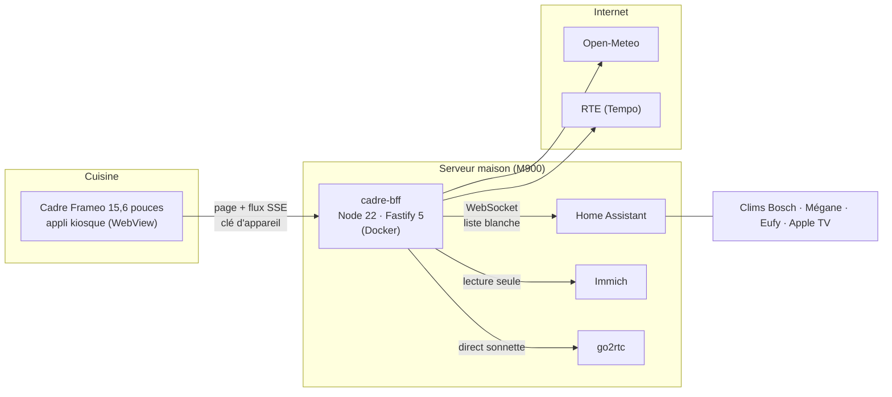

<h1 align="center">🍳 Frameo Kitchen Dashboard</h1>

<p align="center">
  <b>Un cadre photo Frameo à 130 €, transformé en tableau de bord de cuisine pour Home Assistant</b><br>
  <sub>Repas et recettes pas à pas · courses · agenda familial · météo et pollens · maison · voiture · clims · routines des enfants · photos</sub>
</p>

<p align="center">
  <a href="#demo"><b>Démo</b></a> ·
  <a href="#installer"><b>Installer</b></a> ·
  <a href="#documentation-technique"><b>Documentation</b></a> ·
  <a href="#avertissement"><b>Avertissement</b></a> ·
  <a href="#english"><b>English</b></a>
</p>

<p align="center">
  
  
  
  <br>
  
  
  
  
  
</p>

<p align="center">
  
</p>

> [!WARNING]
> **Projet perso, partagé tel quel, sans aucune garantie.** Il est fait pour MA maison : chez toi, il faudra l'adapter.
> Il touche à des choses sensibles (ADB et lanceur d'un appareil, Home Assistant, alarme, voiture, clims). **Tu
> l'utilises à tes risques et périls** : je ne suis responsable ni d'un cadre bloqué, ni d'une garantie perdue, ni d'une
> clim ou d'une voiture pilotée de travers, ni d'une maison mal protégée, ni de quoi que ce soit d'autre.
> Détail : [Avertissement et responsabilité](#avertissement).

> [!CAUTION]
> **Ne jamais exposer ce serveur sur Internet.** Il est conçu pour le réseau local seulement. Toutes les écritures
> (courses, télécommandes, voiture, clims) sont **désactivées par défaut** : ne les active qu'une par une, en sachant ce
> que tu fais.

<details>
<summary><a name="english"></a><b>🇬🇧 In English</b></summary>

<br>

A cheap 15.6" Frameo photo frame (Rockchip RK3326, Android 9), hacked into a kitchen wall dashboard for the family:
meals and step-by-step recipes with timers, shopping list, family calendar, weather and pollen, house (alarm
read-only, doorbell, TV remotes), EV, air conditioners, a morning routine board for kids, and an Immich photo slideshow
when nobody touches it.

A tiny Android **kiosk** app shows a web page served by a small **Node/Fastify backend** in Docker on a home server.
Only that backend talks to **Home Assistant** (non-admin user, entity allow-list) and **Immich** (read-only key), and
every write is behind a separate opt-in flag, simulated by default. Try it without any smart home: `npm ci && npm run
demo`.

The code, comments and docs are in French; the [setup steps](#installer) and [`.env.example`](.env.example)
are the place to start. Inspired by Wes Bos's [photo-frame-dashboard](https://github.com/wesbos/photo-frame-dashboard).

**Disclaimer.** This is a personal project shared as is, with **no warranty of any kind**. It was built for one
specific home. It uses ADB on a consumer device, replaces its launcher, and can drive real devices (car, air
conditioners, TV) through Home Assistant. **Use it at your own risk**: the author is not liable for a bricked frame, a
voided warranty, a misbehaving device, a poorly secured home, or any other damage. Never expose the server to the
Internet. MIT licensed.

</details>

---

## 💡 L'idée

Un cadre photo Frameo à 15,6" (puce Rockchip RK3326, Android 9) recyclé en écran de cuisine. Une petite appli **kiosque**
affiche en plein écran une page web servie par un **serveur intermédiaire** sur le serveur maison (Lenovo M900). Ce
serveur est le seul à parler à **Home Assistant** et à **Immich** : le cadre ne connaît ni jeton, ni mot de passe, ni
adresse interne.

Tout est pensé pour être lu à 2 mètres, touché avec les doigts mouillés, et compris par un enfant de 3 ans.

## 🖼️ Les écrans

<table>
  <tr>
    <td width="50%"><br><b>Aujourd'hui</b> · météo par moment de la journée, gamelle et repas du soir, rendez-vous, rappels</td>
    <td width="50%"><br><b>Météo</b> · heure par heure, 7 jours, pluie dans l'heure, air et pollens</td>
  </tr>
  <tr>
    <td><br><b>Repas</b> · le menu de la semaine, chaque plat ouvre sa recette pas à pas avec minuteurs</td>
    <td><br><b>Courses</b> · la liste partagée de Home Assistant, à cocher du bout du doigt</td>
  </tr>
  <tr>
    <td><br><b>Agenda</b> · un seul agenda familial en grille de semaine, une couleur par personne</td>
    <td><br><b>Enfants</b> · la quête du matin : chaque étape rapporte des minutes d'écran, des points échangeables en boutique</td>
  </tr>
  <tr>
    <td><br><b>Maison</b> · alarme et ouvertures en lecture seule, sonnette avec photo et direct, Wi-Fi invités en QR</td>
    <td><br><b>Télécommandes</b> · Apple TV et télé, applis en appui long pour que les enfants ne coupent pas le film</td>
  </tr>
  <tr>
    <td><br><b>Voitures</b> · batterie et autonomie, charge, clim, phares, klaxon, niveaux de charge</td>
    <td><br><b>Clims</b> · deux clims en entier : marche, mode, consigne, ventilation, oscillations, options</td>
  </tr>
</table>

Et aussi : **mode Photos** (diaporama Immich après 3 minutes sans toucher), **EDF Tempo** (couleur du jour et du
lendemain, alerte la veille d'un jour rouge), **draps** à changer, **thèmes** jour, soir et nuit qui suivent le soleil,
**bandeau sonnette** par-dessus tout écran.

## 🧱 Comment c'est construit



| Brique | Rôle |
|---|---|
| `kiosque/` | appli Android maison : WebView plein écran, lanceur, luminosité, chien de garde Wi-Fi |
| `serveur/` | le serveur intermédiaire : liste blanche des entités, flux SSE vers la page, actions sous garde-fous |
| `web/` | la page : modules ES natifs sans bundler (ES2019 par prudence), grilles CSS, sprite d'icônes |
| `deploiement/` | `deployer.sh` (tests, envoi, build Docker sur le M900, contrôle de santé) et `docker-compose.yml` |
| `tests/` | 64 fichiers `node --test`, faux DOM maison, contraste WCAG calculé sur les feuilles |

## 🔒 Sécurité d'abord

- **Le cadre ne détient aucun secret** : une clé d'appareil révocable, et le serveur parle à Home Assistant avec un
  utilisateur non administrateur.
- **Liste blanche partout** : seules les entités nommées sont lues, jamais la position de la voiture ni son
  kilométrage, jamais l'alarme en écriture (le cadre n'arme ni ne désarme).
- **Quatre garde-fous d'écriture séparés**, simulés par défaut (« Mode essai » à l'écran) : `ACTIONS_REELLES`
  (courses), `ACTIONS_MAISON` (télécommandes, sonnette), `ACTIONS_VOITURE` (voiture), `ACTIONS_CLIM` (clims). Aucun
  n'ouvre les autres, et la connexion à Home Assistant revérifie chacun en dernier verrou.
- **Anti-rafale** sur les commandes qui passent par un cloud (quota de l'API Renault, cloud Bosch).

<a name="demo"></a>

## 🧪 Essayer sans maison (démo)

```bash
npm ci
npm run demo
```

Puis ouvrir dans Chrome l'adresse `http://127.0.0.1:8020/dev/appairer?code=...` écrite dans le journal, fenêtre en
1920 x 1080. Le vrai serveur tourne sur un **faux Home Assistant** (`HA_DEMO=1`) et un faux Immich, avec des données
d'exemple recalées sur la semaine en cours ; la météo est celle de Paris (Open-Meteo, si Internet répond). Tout est en
« Mode essai » : la démo ne peut rien écrire. Les captures de ce README viennent de là.

## 🛠️ Démarrer en développement

```bash
npm ci
npm test
PORT=8027 npm run dev
```

Puis ouvrir dans Chrome l'adresse d'appairage écrite dans le journal au démarrage. Tout le détail est dans la documentation technique ci-dessous.

<a name="installer"></a>

## 🏠 Installer chez soi

Il faut :

- **un cadre photo Android** où l'ADB s'active (beaucoup de Frameo le permettent : À propos, programme bêta). Même nom
  commercial ne veut pas dire même carte : identifier le sien d'abord avec `outils/identifier-cadre.sh` (lecture seule)
  et `web/compat/compat.html`, en suivant [docs/jour-j.md](docs/jour-j.md). La fiche du cadre utilisé ici est
  [docs/cadre-ave948.md](docs/cadre-ave948.md) ;
- **un petit serveur maison** avec Docker et **Home Assistant** (Immich, go2rtc et les intégrations voiture ou clims sont
  facultatifs : chaque écran dit « pas encore relié » tant que sa variable est vide) ;
- Node 22 et, pour l'appli kiosque, un JDK 17 et le SDK Android (sans Gradle).

Les étapes :

1. Dans Home Assistant, créer un **utilisateur non administrateur** dédié (ici « Mur ») et un jeton longue durée à son
   nom. `npm run verif-ha` refuse un jeton admin et liste ce qui manque.
2. Copier `.env.example` en `.env` et remplir ce qui change : `HA_URL`, le lieu de la météo (`LIEU_*`), les calendriers,
   et seulement si besoin les voitures, clims, photos. Le nom des entités de l'alarme, des ouvertures et des
   télécommandes est dans la liste blanche `serveur/ha/entites.js` : l'adapter à sa maison.
3. Adapter `config/enfants.json` (prénoms d'exemple Timo et Pablo, étapes, barème) ou ignorer l'écran Enfants.
4. Lancer en développement (`npm run dev`) et regarder la page dans Chrome à 1920 x 1080.
5. Préparer le serveur et déployer : section [Déploiement](#déploiement-sur-le-serveur-maison).
   **Le serveur reste sur le réseau local** : ne jamais ouvrir son port sur Internet ni sur un réseau partagé.
6. Construire l'appli kiosque avec l'adresse du serveur, l'installer par ADB, lui envoyer la clé du cadre :
   section [Le cadre et le kiosque](#le-cadre-et-le-kiosque) et [docs/recuperation.md](docs/recuperation.md).

Tous les garde-fous d'écriture sont **désactivés par défaut** : tant qu'on ne pose pas `ACTIONS_*=1`, rien n'est envoyé
à la maison, l'écran le dit (« Mode essai »).

**Vocabulaire du code.** Le projet a été écrit pour une maison précise, et les commentaires en gardent les noms :
le **M900** est le serveur maison (un Lenovo M900 Tiny), le **Clevo** le PC d'administration (sa clé d'appareil ouvre
les routes réservées, comme `/api/etat`), **Mur** l'utilisateur Home Assistant du cadre, **Thomas** l'auteur. Les dates
(« choix du 14/10 ») renvoient au journal [docs/conception.md](docs/conception.md).

---

<a name="documentation-technique"></a>

<h1 align="center">Documentation technique</h1>

<details open>
<summary><b>Sommaire</b></summary>

1. [Ce qui tourne chez nous](#chez-nous)
2. [Architecture](#architecture)
3. [Configuration](#configuration)
4. [Écritures et garde-fous](#écritures-et-garde-fous)
5. [Routes de l'API](#routes-de-lapi)
6. [Les écrans](#les-écrans) · [Accueil et Aujourd'hui](#accueil-et-aujourdhui) · [Météo](#météo) · [Repas](#repas) · [Courses](#courses) · [Agenda](#agenda) · [Maison](#maison) · [Photos](#photos) · [EDF Tempo](#edf-tempo) · [Voitures](#voitures) · [Clims](#clims) · [Tableau des enfants](#tableau-des-enfants)
7. [Développement](#développement)
8. [Déploiement sur le serveur maison](#déploiement-sur-le-serveur-maison)
9. [Le cadre et le kiosque](#le-cadre-et-le-kiosque)
10. [Règles du dépôt](#règles-du-dépôt)
11. [Avertissement et responsabilité](#avertissement)
12. [Licence et crédits](#licence)

</details>

Conception d'origine : [docs/conception.md](docs/conception.md). Fiche du cadre : [docs/cadre-ave948.md](docs/cadre-ave948.md).
Récupération en cas de pépin : [docs/recuperation.md](docs/recuperation.md).

---

<a name="chez-nous"></a>

## 📍 Ce qui tourne chez nous

Le serveur tourne dans un conteneur `cadre-bff` sur le M900 et le cadre est fixé au mur de la cuisine depuis le
14/10/2026. Courses, voiture et clims y sont en réel ; télécommandes et direct de la sonnette restent en mode essai
(go2rtc écoute sans mot de passe sur le réseau local, voir « Sonnette »).

---

## Architecture

Trois morceaux : l'appli **kiosque** du cadre (Android, WebView plein écran), la **page** (HTML, CSS et modules ES
natifs, sans bundler) et le **serveur intermédiaire** `cadre-bff` (Node 22, Fastify 5) sur le M900, seul à parler à
Home Assistant (WebSocket, utilisateur « Mur » non administrateur), à Immich (clé en lecture seule), à go2rtc, à
Open-Meteo et à RTE. Le serveur pousse tout l'état à la page par un flux SSE et n'accepte que des actions d'une liste
blanche.

### Le serveur (`serveur/`)

| Fichier | Rôle |
|---|---|
| `index.js`, `app.js` | point d'entrée (configuration, connexion HA, sources, écoute, arrêt propre) ; application HTTP montée telle quelle par les tests |
| `config.js` | variables d'environnement et secrets (voir « Configuration ») ; une valeur invalide arrête le démarrage avec un message en français |
| `securite.js` | deux clés d'appareil, cadre et Clevo (cookie `cadre_cle` ou en-tête `X-Cadre-Cle`), routes réservées au Clevo, 300 requêtes par minute et par IP sur `/api` plus des limites dédiées, masquage des journaux |
| `garde-fous.js` | câblage des quatre garde-fous d'écriture (voir « Écritures et garde-fous »), testé dans tous les sens |
| `source.js` | socle des sources : valeur, `maj` si changement, relecture périodique, nouvel essai à 30 s, 1, 2 puis 5 min |
| `etat-local.js`, `corps.js`, `cadence.js`, `empreinte.js`, `heure-paris.js` | fichiers d'état (écriture atomique, lecture plafonnée et validée) ; lecture d'une réponse sous plafond d'octets ; relais lissé à 256 Ko/s ; empreinte du contenu servi ; heure de Paris |
| `ha/connexion.js` | WebSocket HA : reconnexion seule, ping 30 s, lecture abandonnée au bout de 25 s, dernier verrou des écritures |
| `ha/entites.js` | **liste blanche** des entités lisibles (dont les 9 ouvertures) et des calendriers ; projection sans GPS ni jeton |
| `ha/meteo.js`, `ha/courses.js`, `ha/agenda.js`, `ha/sonnette.js` | prévisions horaires, liste de courses, agenda familial, suivi des coups de sonnette |
| `ha/voitures.js`, `ha/actions-voiture.js` | la Mégane : projection, commandes et anti-rafale (voir « Voitures ») |
| `ha/clims.js`, `ha/actions-clim.js` | les clims : projection, commandes et anti-rafale (voir « Clims ») |
| `ha/actions.js`, `ha/actions-maison.js` | tables d'actions des courses et de la maison, `verifierActions` (domaines et entités interdits) |
| `sources/open-meteo.js`, `sources/tempo.js` | air, pollens, pluie au quart d'heure, 7 jours ; EDF Tempo (RTE, repli, filet local) |
| `sources/menus.js`, `sources/draps.js`, `sources/enfants.js`, `enfants/` | menu publié ; dates des draps ; tableau des enfants (barème, journées, points, mode parent) |
| `sources/immich.js`, `sources/wifi-invites.js`, `sources/direct-sonnette.js` | photos Immich ; fichier du Wi-Fi invités ; relais du direct go2rtc |
| `routes/` | une route par fichier (voir « Routes de l'API ») |

### La page (`web/`)

Modules ES natifs servis tels quels, **sans bundler**. Par prudence (la WebView du cadre est en fait un Chrome 125), le
code s'interdit ce qui dépasse ES2019 (`?.`, `??`, champs privés, import dynamique, `await` de premier niveau) et, en
CSS, le `gap` des flex, `inset`, `aspect-ratio`, `:is`, `:has`, `color-mix`, l'imbrication, `dvh`, `clamp()` et
`backdrop-filter`. `tests/web-compat.test.js` le vérifie.

| Fichier | Rôle |
|---|---|
| `index.html` | scène fixe 1920x1080, polices préchargées, couches communes ; rechargement si le module n'a pas démarré en 10 s |
| `src/main.js`, `src/routeur.js`, `src/pilotage.js` | assemblage et tick unique par seconde ; routeur d'écrans ; règles sans DOM (retour à l'Accueil après 60 s, mode Photos après 3 min, recette oubliée, nuit, rechargement de 4 h) |
| `src/etat.js`, `src/api.js` | magasin alimenté par le flux ; EventSource, chien de garde de 45 s, décalage d'horloge, envoi des actions |
| `src/heure.js`, `src/theme.js`, `src/kiosque.js`, `src/scene.js` | heure de Paris ; thèmes jour, soir (soleil sous -6°) et nuit (20 h 30 à 6 h) ; pont vers l'appli kiosque (luminosité 0,6 / 0,3 / 0,05, volume) ; mise à l'échelle hors 1920x1080 |
| `src/sprite.js` | sprite d'icônes demandé à jour et posé dans la page (la WebView gardait l'ancien `/icones.svg` après un déploiement) |
| `src/rechargement.js`, `src/stockage.js` | rechargement après un déploiement et à 4 h ; localStorage sans exception |
| `src/minuteurs.js`, `src/sonnerie.js`, `src/sons-enfants.js` | minuteurs de cuisine, bips, sons doux des enfants (un seul contexte audio) |
| `src/tempo.js`, `src/sonnette.js`, `src/photos.js`, `src/qr.js`, `src/ciel.js`, `src/air.js`, `src/format.js` | règles sans DOM, testées |
| `src/ecrans/*.js` | un fichier par écran ; les calculs sans DOM sont dans les `*-donnees.js` (testés) |
| `src/composants/` | menu, gestes (`appui.js` : action au lever du doigt, 20 px, 300 ms, appui long), tiroir des minuteurs, bandeaux, avatars, pastilles |
| `styles/` | `jetons.css` (seul fichier avec des couleurs, contrastes WCAG vérifiés par `tests/contraste.test.js`), `base.css`, une feuille par composant et par écran |
| `public/` | polices Fraunces et Nunito Sans (WOFF2 variables, licence OFL), sprite `icones.svg`, `sonde.bin` du chien Wi-Fi |

### Le reste

| Dossier | Rôle |
|---|---|
| `kiosque/` | appli Android `fr.arronis.cuisine` (voir « Le cadre et le kiosque ») |
| `partage/` | schéma et validateur du menu, liste des caractères invisibles refusés ; partagés par le serveur et `outils/cadre.mjs` |
| `config/enfants.json` | barème du tableau des enfants, versionné |
| `outils/` | `cadre.mjs` (menus et courses), `verif-ha.mjs`, `verif-immich.mjs`, `apercu.mjs`, outils du jour J |
| `deploiement/` | `deployer.sh` et `docker-compose.yml` |
| `tests/` | 64 fichiers `node --test`, faux DOM maison, fixtures anonymisées |
| `docs/` | conception, fiche du cadre, récupération, choix du 14/10, captures du README |

---

## Configuration

Tout passe par des variables d'environnement (`.env.example` les décrit une par une). En développement, les valeurs
par défaut sont celles de la maison d'origine (à adapter) ; en production, le compose fixe les siennes et lit `~/cadre/.env` pour ce qui ne
doit pas aller dans le dépôt.

| Variable | Défaut | Production | Rôle |
|---|---|---|---|
| `HA_URL`, `HA_JETON_FICHIER` | M900, `~/.config/cadre/ha_token_dev` | `host.docker.internal:8123`, `/run/cadre/ha_token` | Home Assistant et le jeton de l'utilisateur **Mur** (jamais un jeton admin : `verif-ha` le refuse) |
| `CLE_CADRE_FICHIER`, `CLE_CLEVO_FICHIER` | `~/.config/cadre/cle_dev`, `cle_clevo_dev` | `/run/cadre/cle_cadre`, `cle_clevo` | les deux clés d'appareil, différentes, révocables séparément |
| `PORT`, `HOTE` | 8020, 127.0.0.1 | 8020, 0.0.0.0 | écoute |
| `DOSSIER_WEB`, `DOSSIER_MENUS`, `DOSSIER_ETAT` | `web/`, `data/menus`, `data/etat` | `web`, `/data/menus`, `/data/etat` | page servie, menus publiés, état local |
| `ACTIONS_REELLES`, `ACTIONS_MAISON`, `ACTIONS_VOITURE`, `ACTIONS_CLIM` | vides | dans `~/cadre/.env` | les quatre garde-fous d'écriture, à passer à `1` un par un |
| `AGENDA_CALENDRIERS` | vide | dans `~/cadre/.env` | voir « Agenda » |
| `LIEU_NOM`, `LIEU_LATITUDE`, `LIEU_LONGITUDE` | Paris | dans `~/cadre/.env` | lieu des prévisions Open-Meteo et nom écrit après la date ; les trois ensemble |
| `VOITURES`, `CLIMS` | vides | dans `~/cadre/.env` | voir « Voitures » et « Clims » |
| `WIFI_INVITES_FICHIER` | vide | `/run/cadre/wifi_invites.json` | voir « Wi-Fi invités » |
| `GO2RTC_URL`, `GO2RTC_FLUX_SONNETTE` | M900, vide | vide | voir « Sonnette » |
| `IMMICH_URL`, `IMMICH_CLE_FICHIER`, `IMMICH_SOURCE`, `IMMICH_ALBUM_ID` | M900, vide, `tout` | `/run/cadre/immich_cle`, `tout` ou `~/cadre/.env` | voir « Photos » |
| `IMMICH_DEMO`, `HA_DEMO`, `NODE_ENV` | vides | vides | faux Immich, faux Home Assistant (`npm run demo`) et routes `/dev`, développement seulement (refusés ailleurs) |

Les secrets sont des fichiers en 600, jamais des valeurs dans l'environnement : `~/cadre/secrets/` (700) sur le M900,
monté en lecture seule sous `/run/cadre`.

---

## Écritures et garde-fous

**Par défaut, rien n'est écrit nulle part.** Chaque famille d'écritures a son propre drapeau, qui ne vaut que s'il est
exactement `1` ; sans lui, l'action répond comme en réel (`{ ok: true, simulation: true }`), le journal dit
« simulation », l'écran affiche « Mode essai » et la connexion à Home Assistant n'est jamais appelée.

| Drapeau | Ce qu'il ouvre | Écran |
|---|---|---|
| `ACTIONS_REELLES` | les 4 actions `courses_*` sur `todo.shopping_list` | Courses |
| `ACTIONS_MAISON` | touches Apple TV et télé, applis de l'Apple TV, `script.sonnette_direct` | Maison |
| `ACTIONS_VOITURE` | `button.press` et `number.set_value` sur les entités de commande de `VOITURES` | Voitures |
| `ACTIONS_CLIM` | services `climate.*` et `switch.turn_on` / `turn_off` des entités de `CLIMS` | Clims |

- **Aucun croisement** : un drapeau n'ouvre que sa famille, et la connexion HA revérifie le drapeau et le couple
  service/entité en dernier verrou (`tests/garde-fous.test.js` le prouve dans tous les sens, depuis la configuration).
- **Entités figées au démarrage** : le corps d'une action ne désigne jamais une entité, seulement un nom (voiture,
  clim) et un rôle ou une valeur d'une liste fermée. Corps validés par ajv, `additionalProperties: false` partout.
- **Interdits partout** (`verifierActions`, au démarrage) : tout le domaine `alarm_control_panel` (le cadre n'arme ni ne
  désarme), `select.alarm_center_guard_mode`, `switch.freebox_*`, `button.freebox_*`, `notify.*`, `shell_command.*`,
  `remote.turn_off`, tout script autre que `script.sonnette_direct` ; `button` et `number` réservés à la voiture,
  `climate` et `switch` aux clims.
- **Pas de protection contre les enfants** sur les voitures et les clims (choix de Thomas) ; seulement un anti-rafale
  pour les quotas des clouds Renault et Bosch.
- Passer une famille en réel : poser le drapeau (compose ou `~/cadre/.env`), redéployer.

---

## Routes de l'API

Tout `/api` exige une clé d'appareil, sauf `/api/sante`. Réponses JSON, `cache-control: no-store` sur ce qui bouge.

| Route | Clé | Rôle |
|---|---|---|
| `GET /api/sante` | aucune | `{ ha, version, empreinte }` |
| `GET /api/flux` | cadre ou Clevo | flux SSE : `instantane` à la connexion, puis `maj` à chaque changement, `menu` à chaque publication, `ping` toutes les 20 s ; client qui ne lit plus coupé à 256 Ko en attente |
| `GET /api/menu` | cadre ou Clevo | le menu retenu ou `null` |
| `POST /api/action/:nom` | cadre ou Clevo, 60 par minute | une action de la liste blanche (courses, maison, voiture, clim) ; touches de télécommande à part, 10 par seconde |
| `POST /api/drive-pret` | cadre ou Clevo, 10 par minute | « Prêt pour le drive » : date écrite dans `drive.json` |
| `POST /api/draps/:lit` | cadre ou Clevo, 10 par minute | voir « Draps » |
| `/api/enfants/*` | cadre ou Clevo, 60 par minute | voir « Tableau des enfants » |
| `GET /api/sonnette.jpg`, `GET /api/sonnette.mjpeg` | cadre ou Clevo | photo de la sonnette ; direct go2rtc (seulement s'il est configuré) |
| `GET /api/wifi-invites` | cadre ou Clevo | nom, mot de passe et chaîne du QR (jamais dans le flux) |
| `GET /api/photos/lot`, `GET /api/photos/<id>.jpg` | cadre ou Clevo | voir « Photos » |
| `GET /api/courses`, `GET /api/etat` | Clevo seulement | liste de courses et date du drive, pour `outils/cadre.mjs` |

Le flux porte `heure_serveur` (la page en tire le décalage de son horloge), l'état de HA, les quatre modes
(`simulation`, `simulation_maison`, `simulation_voiture`, `simulation_clim`), `direct_video`, `photos_configurees`,
`empreinte`, puis une valeur par source : `entites` (seules les entités changées dans une `maj`), `meteo`, `courses`,
`agenda`, `sonnette`, `air`, `pluie`, `semaine`, `menu`, `draps`, `tempo`, `voitures`, `clims`, `enfants`. Jamais
d'entity_id de voiture ni de clim, jamais de GPS, jamais de jeton. Une erreur imprévue répond
`500 { erreur: "erreur_interne" }`, le détail ne va qu'au journal.

---

## Les écrans

Le menu à gauche compte 9 entrées de 86 px : Accueil, Météo, Repas, Courses, Maison, Agenda, Enfants, Voitures, Clims.
Toute navigation réagit au contact du doigt (`pointerdown`), toute action au lever (20 px de tolérance, 300 ms
d'anti-répétition). Chaque écran revient à l'Accueil après 60 s sans toucher (90 s pour les enfants), sauf recette,
alerte, direct ou Wi-Fi affiché. Le pied du menu dit « à jour », « hors ligne depuis… » ou « maison injoignable ».

### Accueil et Aujourd'hui

- **Accueil** : l'heure en très gros, la température et le ciel à sa droite, la date et la ville, la pluie dans l'heure
  seulement s'il en tombe ; « Ce soir » (« Ce midi » le week-end avant 14 h) avec le bouton Recette ; les cartes Courses
  et Air et pollens ; « La semaine » à droite (ciel, maxi, mini, repas du soir et rendez-vous de chaque jour, pastille
  Tempo du 1er novembre au 31 mars) ; en bas, Minuteur, Alarme (état et ouvertures), la case des deux visages le matin
  (sinon Wi-Fi invités, ou la case Tempo la veille d'un rouge ou d'un blanc), Apple TV.
- **Encart « Aujourd'hui »** à droite de la date : une icône et un nombre par sujet qui reste à faire (rendez-vous,
  rappels, alertes), « rien de prévu » sinon ; un toucher ouvre la page.
- **Page Aujourd'hui** : quatre cartes fixes, Météo (matin, après-midi, soir), Repas (gamelle ou midi, soir, Recette),
  Rendez-vous (à l'heure, puis « Journée »), À prévoir (rappels du menu), et une bande d'**alertes** quand il y en a :
  veille d'un jour Tempo rouge ou blanc, ouvertures ouvertes, voiture à brancher, draps, air à partir de « dégradé »,
  pollen élevé, encre sous 15 %, piles faibles. En haut à droite, l'entrée Tempo, toute l'année.
- **Hors ligne** (flux muet depuis 45 s) : un bandeau prend la place de la barre du bas de l'Accueil, jamais celle de
  l'heure.

### Météo

Un détail n'apparaît que s'il sert. En tête : pictogramme, température et ciel (`weather.forecast_maison`, met.no via
HA), le vent seulement à partir de 40 km/h. « Prochaines heures » : la pluie dans l'heure au quart d'heure (Open-Meteo,
modèle `meteofrance_seamless`) et 48 heures de met.no qui défilent du doigt. 7 jours (Open-Meteo) : la pluie au-delà de
0,5 mm, le vent à partir de 40 km/h. Air et pollens : le niveau de l'indice européen en mot, les pollens présents
(seuils **provisoires**, marqués [S] dans `web/src/air.js`). Unités toujours lues dans les données. Crédits en pied :
met.no, Open-Meteo.com (CC BY 4.0), CAMS/Copernicus.

### Repas

Le menu de la semaine (du samedi au vendredi) est préparé par le skill `/menu`, validé contre
`partage/schema-menu-v1.json` puis publié sur le M900 par `outils/cadre.mjs publier` ; il arrive par le flux, sans
rechargement.

- **Écran Repas** : 7 lignes, midi et soir ; les midis de semaine sont les gamelles du plat de la veille. Étiquettes,
  temps, accompagnement ; toucher une carte ouvre la recette.
- **Recette pas à pas** (plein écran) : ingrédients cochables à gauche (gardés par recette jusqu'au cycle suivant),
  étape en 44 px, badge four ou gril, bouton « Lancer Saucisson 35 min », Précédent et Suivant, astuces en fin. Elle
  reste ouverte jusqu'à ce qu'on la ferme (refermée seule après 2 h sans toucher et sans minuteur).
- **Minuteurs** : tiroir ouvert par le bouton Minuteur, la pastille ou un minuteur d'étape ; -1, +1, +5 min, 5
  minuteurs au plus ; Annuler rétablissable 5 s. Fin gardée en heure corrigée par le serveur : un rechargement ne perd
  rien. Sonnerie de 3 bips par seconde jusqu'au toucher, alerte plein écran par-dessus tout (nuit comprise), volume
  remonté à 80 % s'il est plus bas, « Encore 5 min » ou « Encore 1 min ».
- **Nuit** de 20 h 30 à 6 h : l'heure seule, atténuée ; un toucher montre l'Accueil, 60 s plus tard il se rendort. Une
  recette ouverte garde l'écran éveillé. Rechargement de la page à 4 h, reporté tant qu'un minuteur tourne, qu'une
  recette est ouverte ou qu'on vient de toucher.

### Courses

La liste `todo.shopping_list` de Home Assistant, partagée avec les iPhones. Toucher un article coche ou décoche (il
garde sa place 4 s, puis la liste se trie) ; appui long d'une seconde puis confirmation pour supprimer ; champ d'ajout
(60 caractères, sans caractère invisible : un caractère bidi maquillerait l'article, une demi-paire couperait la
connexion de HA) ; « Vider les cochés » avec confirmation qui nomme les articles ; « Prêt pour le drive ». Mise à jour
optimiste puis réconciliation avec le flux ; un refus remet la liste d'avant et nomme l'article.

### Agenda

Un seul agenda familial : les rendez-vous de tous les calendriers reliés dans une même semaine, avec une couleur et une
initiale **par personne**. Lecture seule (`calendar.get_events`, quatre semaines, toutes les 15 min et à chaque
changement d'un calendrier).

- **Écran** : sept colonnes du lundi au dimanche, la rangée « journée entière » en haut, les heures de 7 h à 19 h
  (élargies jusqu'à 6 h et 23 h si besoin), un bloc par rendez-vous à la couleur de sa personne, deux côte à côte au
  plus puis « +N », la ligne de l'heure actuelle ; semaine précédente, « Cette semaine » et les deux suivantes ; un
  toucher sur un bloc ouvre sa fiche.
- **Accueil** (« La semaine ») et **page Aujourd'hui** : les rendez-vous du jour avec leur pastille.
- **Ajouter un calendrier** : relier le compte dans HA (iCloud par l'intégration CalDAV avec un mot de passe
  d'application, Google par l'intégration Google Calendar), relever les entités `calendar.*`, puis compléter
  `AGENDA_CALENDRIERS` dans `~/cadre/.env`, une entrée par calendrier avec le prénom de la personne
  (`calendar.domicile=Camille,calendar.travail=Camille,calendar.xxx=Sacha`), et redéployer. `npm run verif-ha` vérifie
  qu'ils existent. Mal écrit, sans prénom ou répété : refus au démarrage.
- Des événements, seuls sortent titre, début, fin, journée entière, lieu et personne : ni description ni participants ;
  un lien de visio dans le lieu devient « Visio ». Un même rendez-vous dans deux calendriers d'une personne n'apparaît
  qu'une fois. Un calendrier absent ou en échec est signalé sous le titre de l'écran et garde ses rendez-vous lus.

### Maison

Six onglets. **Le cadre n'arme ni ne désarme l'alarme** (il est loin de l'entrée) : pas de « Je pars », pas de « qui est
à la maison ».

- **Alarme** : l'état en grand et depuis quand, « Tout est fermé » ou « 2 ouvertures », les 9 ouvertures (ouvertes en
  tête, depuis quand, pile faible).
- **Apple TV** et **Télé** : pavé, OK, retour, « Menu TV », lecture, volume, allumer et veille ; les applis de vidéo
  (liste `APPLIS_AFFICHEES` de `web/src/ecrans/maison-telecommandes.js`). **Veille et applis à l'appui long d'une
  seconde** : un enfant ne coupe pas le film du séjour. En mode essai : « Essai : touche non envoyée ».
- **Sonnette**, **Wi-Fi invités** : ci-dessous. **Entretien** : les draps, les encres de l'imprimante et les piles
  faibles nommées avec leur appareil.

#### Sonnette

- **Bandeau** par-dessus tout écran quand `binary_sensor.doorbell_ringing` passe à `on` : « On a sonné · 19:41 » et la
  photo **de ce coup-là** seulement (« Photo en cours… », puis la photo, ou « Pas de photo de ce coup ») ; il réveille
  l'écran, se masque après 2 min ou au premier toucher (qui ne déclenche rien dessous).
- **De quand date la photo** : `camera.sonnette_derniere_photo` n'est réécrite que 7 à 20 s après la sonnerie, et pas
  toujours. Le serveur suit chaque coup et relit l'empreinte de la photo toutes les 3 s pendant 45 s : le flux dit
  `en_cours`, `du_coup` ou `avant_coup`. Photo lue en REST (5 s, 3 Mo au plus, jeton en en-tête).
- **Direct vidéo** : prévu (`GET /api/sonnette.mjpeg` relaie go2rtc après `script.sonnette_direct`, 3 min 30 s, deux
  directs au plus) mais **laissé désactivé** : le go2rtc de HA écoute le réseau local **sans authentification** (1984,
  8554, 8555), n'importe quel appareil du réseau pourrait regarder la sonnette sans passer par le cadre. Avant de
  remplir `GO2RTC_FLUX_SONNETTE` (numéro de série, hors dépôt) : limiter ces ports au M900 ou activer
  l'authentification de go2rtc (le serveur du cadre devra alors envoyer un en-tête Basic).

#### Wi-Fi invités

- Fichier secret `wifi_invites.json` (600) : `{ "ssid": "…", "mot_de_passe": "…", "securite": "WPA2" }` (`WPA`, `WPA2`,
  `WPA3` ou `nopass`), relu à chaque demande. Le déposer sans passer par une conversation :
  `ssh -t thomas@192.168.1.187 'umask 077 && nano ~/cadre/secrets/wifi_invites.json'`.
- Rien de secret à l'écran avant un toucher sur « Afficher » : QR, nom et mot de passe en gros (chasse fixe, chiffres
  d'une autre couleur), masqués après 2 min. Le mot de passe ne passe jamais par le flux.
- QR écrit sans bibliothèque (`web/src/qr.js`, mode octet, correction M, versions 1 à 10), vérifié contre OpenCV.
- Côté Freebox : clé invité « Internet seulement », sans expiration, sans `I`, `l`, `O` ni `0`.

#### Draps

Trois cartes en haut de l'onglet Entretien (Lit de Timo, Lit de Pablo, Notre chambre) : « changés il y a 3 jours », la
jauge du cycle de 15 jours, l'échéance. « Changés aujourd'hui » (annulable 5 s), ou à l'appui long « Hier » et
« Avant-hier ». Rappel dès 2 jours avant l'échéance dans les alertes de la page Aujourd'hui seulement.
`POST /api/draps/:lit` (`timo`, `pablo`, `parents`), corps `{ "quand": "aujourdhui" | "hier" | "avant-hier" }` : le
serveur calcule la date et écrit `data/etat/draps.json`. Rien dans HA.

### Photos

Quand personne ne touche l'écran depuis **3 minutes**, les photos d'Immich défilent : une photo plein écran (ou deux
portraits côte à côte), fondu de 1,5 s toutes les 30 s, pastilles en verre (heure, météo, repas du soir, minuteur,
légende « Annecy · juillet 2024 »). Un toucher ramène l'Accueil sans rien déclencher. Jamais pendant une recette, une
alerte, le bandeau sonnette, la nuit, un direct, le minuteur d'écran de Timo ni hors ligne.

- **Lecture seule** : clé API Immich avec `asset.read` et `asset.view` seulement, dans `~/cadre/secrets/immich_cle`.
  `IMMICH_SOURCE` : `tout` (au hasard dans toute la photothèque, réglage actuel), `favoris`, ou `album` avec
  `IMMICH_ALBUM_ID`. `npm run verif-immich` contrôle la version (3.2 au moins), un lot et une photo.
- Lot : `POST /api/search/random` (100 photos, images seulement, ni archivées, ni verrouillées, ni à la corbeille),
  relu toutes les 30 min. **Seules les photos d'un lot rendu depuis moins de 2 h sont relayées** ; chaque photo est
  revérifiée juste avant (corbeille, archive : 410) puis relayée sans redimensionnement, **lissée à 256 Ko/s** (le
  Wi-Fi du cadre décrochait après une photo envoyée d'un bloc).
- Côté page : une seule vue préchargée ; une vue pas prête en 20 s compte comme un échec ; la première vue se prépare
  pendant la minute qui précède, et le mode ne s'ouvre qu'une fois elle chargée (jamais d'écran vide).
- `IMMICH_DEMO=1 npm run dev` remplace Immich par un faux serveur de sept images (développement seulement).

### EDF Tempo

Pour les abonnés au tarif Tempo. Lecture seule, sans compte ni clé, rien dans HA.

- **Sources** : le JSON public de RTE (`tempoLight` et la saison), repli `api-couleur-tempo.fr` si RTE échoue, filet
  `data/etat/tempo.json`. Règles fixes qui rejettent une couleur absurde (dimanche bleu, pas de rouge le week-end, les
  fériés de l'hiver ni d'avril à octobre). Lu à 6 h 05, toutes les 30 min tant que demain manque, à 10 h 45, 11 h 15 et
  12 h 30. Jour Tempo de 6 h à 6 h ; une couleur lue la veille avant 10 h 40 est une pré-annonce.
- **Sur l'Accueil, du 1er novembre au 31 mars seulement** : pastilles de « La semaine » (pointillés si pré-annoncée),
  la case « Demain rouge » (ou blanc) à la place de Wi-Fi invités dès la pré-annonce, puis « Heures creuses, les
  machines ! » à 22 h (visible en réveillant l'écran : la nuit commence à 20 h 30), et un liseré rouge de 8 px en haut
  de tous les écrans un jour rouge, de 6 h à 22 h.
- **Toute l'année** : l'entrée Tempo de la page Aujourd'hui ouvre la fiche (aujourd'hui, demain, jours restants,
  heures creuses de 22 h à 6 h), et l'alerte « Demain rouge » ou « Demain blanc ».

### Voitures

Une Renault Mégane électrique, par l'intégration Renault de HA. **Toutes ses commandes** sont sur le cadre, d'un simple
appui, **sans protection contre les enfants** (choix de Thomas). Le cadre ne lit jamais la position ni le kilométrage.

- **Écran** : le nom, l'état (Débranchée, Branchée, En charge avec « prête vers 6 h 40 », Charge programmée, Erreur), le
  pourcentage en 240 px, l'autonomie, une jauge en forme de batterie (rouge à 25 % ou moins) ; carte grisée et « vu il
  y a 9 h » quand la donnée a plus de 6 h. Dessous : Charger, Clim, Phares, Klaxon, et les niveaux « − 45 % + » de
  charge mini et cible (envoyés 1,5 s après le dernier appui).
- **Alerte du soir** : de 18 h à minuit, à 25 % ou moins et débranchée, « Mégane · 18 % · à brancher » dans les alertes
  de la page Aujourd'hui (jamais sur l'Accueil).
- La donnée est la dernière que la voiture a envoyée à Renault : HA la relève toutes les 6 à 7 min (quota de 60
  requêtes par heure et par compte), une voiture endormie n'envoie plus rien.

**La variable `VOITURES`** (dans `~/cadre/.env` : les entity_id de Renault contiennent la plaque), deux voitures au plus
séparées par `;`, sur une ligne :

```
VOITURES='Mégane: batterie=sensor.x_batterie, branchee=binary_sensor.x_branchee, autonomie=sensor.x_autonomie, charge=sensor.x_etat_de_charge, activite=sensor.x_derniere_activite_de_la_batterie, restant=sensor.x_temps_de_charge_restant, charger=button.x_commencer_la_charge, clim=button.x_demarrer_la_climatisation, phares=button.x_faire_un_appel_de_phares, klaxon=button.x_klaxonner, charge_min=number.x_niveau_de_charge_minimal, charge_cible=number.x_niveau_de_charge_cible'
```

| Rôle | Entité (domaine) | |
|---|---|---|
| `batterie`, `branchee` | Battery (`sensor`), Plug (`binary_sensor`) | obligatoires |
| `autonomie`, `charge`, `restant` | Battery autonomy (HA en système Métrique), Charge state, Charging remaining time (`sensor`) | facultatifs |
| `activite` | Last battery activity (`sensor`, désactivée par défaut dans HA, à activer : sans elle, jamais grisée) | facultatif |
| `charger`, `clim`, `phares`, `klaxon` | Start charge, Start air conditioner, Flash lights, Sound horn (`button`) | boutons |
| `charge_min`, `charge_cible` | niveaux de charge minimal (15 à 45 %) et cible (55 à 100 %), pas de 5 (`number`) | réglages |

Le nom avant `:` est celui que le cadre affiche, jamais celui de HA. Refusé au démarrage, avec un message qui cite la
voiture et le rôle (jamais l'entity_id) : rôle inconnu ou répété, mauvais domaine, entité qui parle de position ou de
kilométrage, plus de deux voitures.

**Commandes** (`POST /api/action/:nom`, sous `ACTIONS_VOITURE`) :

| Action | Corps | Appel HA |
|---|---|---|
| `voiture_commande` | `{ "voiture": "Mégane", "commande": charger, clim, phares, klaxon }` | `button.press` |
| `voiture_niveau` | `{ "voiture": "Mégane", "reglage": charge_min, charge_cible, "valeur": entier }` | `number.set_value`, contrôlé contre les bornes et le pas actuels |

Anti-rafale pour le quota Renault (en simulation aussi) : une même commande toutes les 30 s, un même réglage toutes les
10 s, **10 commandes par heure glissante** au plus, toutes voitures confondues (`429 trop_tot` au-delà). Aucun entity_id
dans les réponses ni le journal (« Mégane · klaxon »).

### Clims

Deux clims Bosch (Salon, Étage) reliées à HA par l'intégration HACS **Bosch HomeCom** (cloud Bosch ; les modules Wi-Fi
n'ont rien à piloter en local). Pilotées en entier depuis l'entrée « Clims » du menu, **sans protection contre les
enfants**.

- **Écran** : un panneau par clim, côte à côte : nom et bouton Allumée / Éteinte, température de la pièce, consigne
  « − 25° + », modes Froid, Chaud, Auto, Sec, Vent (choisir un mode allume la clim), ventilation Auto, Silence, 1, 2, 3,
  Turbo, oscillations Haut-bas et Côtés, options Éco, Boost, Nuit, Ions, Pas sur moi, Hors-gel. Seulement ce que la clim
  accepte ; une option que la clim ne laisse pas changer maintenant (Éco quand elle est éteinte, attribut
  `writable_now`) est grisée. Une commande partie garde sa valeur en pointillés jusqu'à ce que HA la rapporte (60 s au
  plus). Clim injoignable : carte grisée.
- **Intégration** : HACS, puis « Bosch HomeCom » dans son catalogue, puis l'intégration avec un code d'autorisation
  SingleKey ID relevé dans l'onglet Réseau du navigateur (`-1` final compris, à usage unique ; voir le README du projet
  `serbanb11/bosch-homecom-hass`).

**La variable `CLIMS`** (dans `~/cadre/.env`), deux clims au plus séparées par `;`, sur une ligne :

```
CLIMS='Salon: climat=climate.climatisation_salon, eco=switch.climatisation_salon_eco, boost=switch.climatisation_salon_boost, sommeil=switch.climatisation_salon_sleep_mode, ioniseur=switch.climatisation_salon_ionizer, pas_sur_moi=switch.climatisation_salon_wind_avoid_me, hors_gel=switch.climatisation_salon_8_degc_heating ; Étage: climat=climate.climatisation_etage, ...'
```

`climat` (climate) obligatoire, les six options (switch) facultatives ; mauvais domaine, rôle inconnu ou répété, entité
qui sert deux fois, plus de deux clims : refus au démarrage.

**Commandes** (`POST /api/action/:nom`, sous `ACTIONS_CLIM`) :

| Action | Corps | Appel HA |
|---|---|---|
| `clim_marche` | `{ "clim", "marche": true/false }` | `climate.turn_on` / `turn_off` |
| `clim_mode` | `{ "clim", "mode": cool, heat, auto, dry, fan_only }` | `climate.set_hvac_mode` |
| `clim_consigne` | `{ "clim", "valeur" }` | `climate.set_temperature`, contrôlée contre min, max et pas actuels |
| `clim_ventilation` | `{ "clim", "ventilation": auto, quiet, low, medium, high, turbo }` | `climate.set_fan_mode` |
| `clim_oscillation` | `{ "clim", "sens": verticale, horizontale, "actif" }` | `climate.set_swing_mode` / `set_swing_horizontal_mode` |
| `clim_option` | `{ "clim", "option": eco, boost, sommeil, ioniseur, pas_sur_moi, hors_gel, "actif" }` | `switch.turn_on` / `turn_off` |

Refus : `404 clim_inconnue` ou `commande_absente`, `503 commande_indisponible` (clim injoignable, valeur refusée, option
pas modifiable maintenant), `503 bornes_inconnues`, `429 trop_tot` (même commande d'une même clim au plus toutes les
2 s, 120 commandes par heure glissante), `502 action_echouee`.

### Tableau des enfants

Les routines de deux enfants, un grand qui gagne des minutes d'écran et un petit qui gagne des étoiles (Timo et Pablo
sont des prénoms d'exemple : ils se changent dans `config/enfants.json`, les lits des draps dans
`web/src/ecrans/draps-donnees.js`). Visuel, peu de texte, **rien de punitif** (ni croix, ni rouge,
on ne retire jamais de minutes ni de points par punition), jamais les deux frères côte à côte. Rien dans Home
Assistant : tout reste dans `data/etat/enfants`, et le cadre ne pilote pas la tablette.

#### Écrans

- **Entrée** : deux cartes (le renard de Timo, l'ourson de Pablo), une étoile dorée quand la routine du matin est
  finie. Le matin (5 h à 9 h), la case des deux visages de l'Accueil ouvre directement le tableau d'un enfant.
- **Mode enfant** : menu masqué, bouton maison, les deux visages pour passer de l'un à l'autre, retour à l'Accueil après
  90 s.
- **La quête du matin de Timo** : un chemin de cases rondes (Levé, Déjeuner au calme, Dents, Habillé, Cartable,
  N'excite pas Pablo) jusqu'au coffre. **Appui long d'une seconde** pour valider (un anneau d'or se remplit), la pièce
  vole vers la bourse ; Annuler pendant 5 s. Le renard se tient sur la première case à faire. Barre du temps jusqu'au
  départ de 8 h 10. À 9 h, les cases restantes passent en gris.
- **La bourse et le minuteur d'écran** : les minutes de YouTube Kids qu'il peut encore regarder ; « Je regarde » lance un
  disque façon Time Timer (pause, fini), une pastille le suit sur les autres écrans, et à la fin « Fin de la vidéo, puis
  on éteint ». Minutes perdues à 20 h.
- **Les points et la boutique** : le total, les derniers gains, trois cadeaux (30, 60, 90) avec « Je veux ça » ; le gros
  bouton d'or « ★ +1 » en haut de son écran, que tout le monde peut toucher (10 par journée, annulable 5 s).
- **Pablo** : « D'abord, ensuite » : trois grandes cartes (petit déjeuner, dents, chaussures), une étoile vers son
  bocal à chaque toucher, puis « Ensuite : une histoire ». Aucun texte.

#### Le mode parent

**Appui long de 3 s sur le visage d'un enfant** (le contrôleur tactile du cadre ne suit que deux doigts : le geste à
trois doigts était impossible). Rien ne se voit pendant les 3 s, puis 60 s de mode parent (bandeau, temps restant,
Fermer) : valider, refuser, cocher un oubli ou décocher une étape ; pour Timo, « +1 » avec motif (Bravo, A rangé, A mis
la table, A aidé), « −1 » (le dernier gain), valider ou refuser un échange ; les 7 derniers jours. Le serveur délivre un
jeton de 60 s (`POST /api/enfants/parent`, en-tête `X-Cadre-Parent`) : **une barrière contre les doigts d'enfants, pas
une sécurité**, rien de dangereux n'en dépend.

#### Côté serveur

- **Le barème** `config/enfants.json`, versionné et validé au démarrage (un barème faux arrête le serveur en disant où) :

  | | Timo (minutes de YouTube Kids) | Pablo (étoiles) |
  |---|---|---|
  | Étapes | Levé 10 (pas avant 6 h 30), Déjeuner au calme 5, Dents 3, Habillé 5, Cartable 5, N'excite pas Pablo 4 ; toutes en confiance (Timo coche, un parent corrige) | Petit déjeuner, Dents, Chaussures |
  | Plafond | 32 minutes, perdues à 20 h | aucun |
  | Points | +1 par action, 10 points libres par journée, boutique 30, 60, 90 | aucun |

  Pour changer une valeur : modifier le fichier, mettre à jour `tests/enfants-bareme.test.js`, `npm test`, déployer.
- **Les règles** : journée de 4 h à 4 h ; routine du matin close à 9 h (`fin_routine`) ; annulation 5 s par n'importe
  qui pour une coche de l'enfant, sans délai par un parent ; minuteur d'écran borné par les minutes gagnées et 20 h ;
  20 gains de points au plus par journée ; une seule demande d'échange en attente ; le solde ne descend jamais sous 0.
- **Les fichiers** : `data/etat/enfants/journees/AAAA-MM-JJ.json` (une journée, 16 Ko au plus) et `registre.json` (les
  points, 256 Ko au plus) ; ni prénom ni libellé, seulement des identifiants, des heures et des
  nombres. 90 jours gardés, les vieux points repliés dans un report (le solde ne change pas).
- **Les routes** `/api/enfants/*` : `parent`, `:enfant/etapes/:etape` (et `annuler`, `decision`), `:enfant/points` (et
  `retirer`, `libre`, `libre/annuler`), `:enfant/echanges` (et `decision`), `:enfant/minuteur`, `historique`. La page
  n'envoie jamais ni date, ni heure, ni nombre : des identifiants et des mots d'une liste fermée. Refus en codes clairs
  (`409 routine_finie`, `trop_tot`, `plafond_libre`, `points_insuffisants`…, `403 mode_parent_requis`).
- **Dans le flux** : la valeur `enfants` complète à chaque action, à la fin du minuteur, à 9 h, 20 h et 4 h ; la page
  compte elle-même les secondes avec son heure corrigée.

---

## Développement

### Installer

```bash
npm ci
mkdir -p ~/.config/cadre data/menus
[ -e ~/.config/cadre/cle_dev ] || (umask 077 && node -e "process.stdout.write(require('node:crypto').randomBytes(32).toString('hex'))" > ~/.config/cadre/cle_dev)
```

Le jeton HA de développement (utilisateur Mur) va dans `~/.config/cadre/ha_token_dev` (600) ; ne jamais utiliser
`~/homeassistant/ha_token` du M900 (admin). La clé du Clevo de développement est créée au premier lancement. Pour
changer une valeur, copier `.env.example` en `.env` (non versionné).

### Lancer et regarder la page

```bash
PORT=8027 npm run dev
```

Ouvrir dans Chrome **l'adresse d'appairage écrite dans le journal** (`/dev/appairer?code=…`) : elle pose le cookie de
la clé et renvoie vers la page. Elle n'existe qu'en développement, depuis la boucle locale, avec un code tiré à chaque
démarrage. Ajouter `&theme=soir` (ou `jour`, `nuit`) pour forcer un thème. Variables utiles devant la commande :
`CLIMS=…`, `VOITURES=…`, `AGENDA_CALENDRIERS=…`, `IMMICH_DEMO=1`. Rien n'est écrit tant que les drapeaux ne valent pas
`1`.

- Un fichier **modifié** dans `web/` est servi à jour ; un fichier **ajouté** demande de relancer le serveur.
- Hors de 1920x1080, la scène est réduite : juger des tailles en plein écran ou par une capture headless
  (`google-chrome --headless=new --window-size=1920,1080 --timeout=5000 --screenshot=… '<adresse d'appairage>'`).
- Essayer le menu : `CADRE_DEST_LOCAL=data/menus node outils/cadre.mjs publier tests/fixtures/menu-2026-10-10.json`.

### Tests et vérifications

```bash
npm test               # 723 tests, sans réseau ni HA ni Immich ni RTE
npm run verif-ha       # lecture seule : entités de la liste blanche, cibles des actions, VOITURES et CLIMS
npm run verif-immich   # lecture seule : version d'Immich, un lot et une photo
```

Les tests couvrent le serveur (liste blanche, garde-fous, sources, sécurité, flux), les règles de la page sans DOM, les
écrans sur un faux DOM, les contrastes WCAG de chaque thème et la compatibilité du code. `verif-ha` sort en 1 s'il
manque une entité ou si le jeton est admin : à relancer après chaque mise à jour de HA.

### Outils

| Commande | Rôle |
|---|---|
| `node outils/cadre.mjs verifier <menu.json>` | valide un menu (code 1 et motifs sinon) |
| `node outils/cadre.mjs publier <menu.json>` | publie sur le M900 par rsync (clé `~/.ssh/cadre_menus`, sans phrase de passe, bornée par rrsync) |
| `node outils/cadre.mjs liste` | menus publiés sur le M900 |
| `node outils/cadre.mjs etat`, `cocher <uid>…` | date du drive et liste de courses ; cocher avec confirmation (caractères invisibles écrits en clair) |
| `npm run demo` (`outils/demo.mjs`) | le tableau de bord sur un faux Home Assistant, sans maison ; voir « Essayer sans maison » |
| `node outils/apercu.mjs` | relais sur `http://127.0.0.1:8021` vers le vrai tableau de bord, avec la clé du Clevo (`~/.config/cadre/cle`, copie de `secrets/cle_clevo`). **Les actions y sont réelles.** |

---

## Déploiement sur le serveur maison

Les commandes ci-dessous visent le serveur d'origine (`thomas@192.168.1.187`) : remplacer par le sien. Le script
lit `HOTE_M900` et `URL_SANTE` :

### Déployer

```bash
HOTE_M900=moi@192.168.1.50 URL_SANTE=http://192.168.1.50:8020/api/sante bash deploiement/deployer.sh
```

Arbre git propre exigé ; tests locaux, contrôle de `~/cadre` (secrets lisibles par l'uid 1000), envoi des sources dans
`~/cadre/src`, `docker compose build` et `up -d` sur le M900, succès seulement quand `/api/sante` répond `"ha":"ok"`.
L'image précédente est gardée sous `cadre-bff:precedent`. Retour arrière :

```bash
ssh thomas@192.168.1.187 'cd ~/cadre && docker tag cadre-bff:precedent cadre-bff:local && docker compose up -d'
```

Changer une ligne de `~/cadre/.env` (`VOITURES`, `CLIMS`, un drapeau) : la modifier sur le M900 (copie de sauvegarde
d'abord), puis redéployer ou `docker compose up -d` dans `~/cadre`.

### La page se recharge d'elle-même

Le serveur calcule au démarrage l'empreinte du contenu servi et la met dans le flux et `/api/sante`. Quand une
reconnexion en annonce une autre, la page se recharge, mais pas pendant un minuteur, une recette, l'écran des enfants
ou le bandeau sonnette, ni avant 60 s sans toucher. Le sprite d'icônes est redemandé à jour à chaque chargement.

### Fichier d'état abîmé

`~/cadre/data/etat` tient ce que le cadre écrit lui-même : `draps.json`, `tempo.json`, `drive.json` et `enfants/`. Un
fichier abîmé (JSON cassé, champ en trop, trop gros) n'est **jamais écrasé** : il est renommé
`<nom>.abime-AAAAMMJJ-HHMMSS`, une erreur part au journal et le serveur repart de zéro pour ce fichier. Pour récupérer
(les points de Timo par exemple) : corriger le fichier mis de côté, arrêter le conteneur, lui rendre son nom,
redémarrer. Les trouver : `ssh thomas@192.168.1.187 'find ~/cadre/data/etat -name "*.abime-*"'`.

### Préparer un M900 neuf (une seule fois)

```bash
ssh thomas@192.168.1.187 'umask 077 && mkdir -p ~/cadre/secrets ~/cadre/src ~/cadre/data/menus ~/cadre/data/etat \
  && for c in cle_cadre cle_clevo; do [ -f ~/cadre/secrets/$c ] || head -c 32 /dev/urandom | od -An -tx1 | tr -d " \n" > ~/cadre/secrets/$c; done'
read -rs T && ssh thomas@192.168.1.187 'umask 077 && cat > ~/cadre/secrets/ha_token' <<< "$T" && unset T
```

Le jeton est celui de l'utilisateur HA **Mur** (profil, Sécurité, Jetons d'accès longue durée). La clé Immich se dépose
de la même façon dans `secrets/immich_cle`. Contrôle : `stat -c "%u %a %n" ~/cadre/secrets ~/cadre/secrets/*` doit
montrer `1000 700` pour le dossier et `1000 600` pour chaque fichier.

---

## Le cadre et le kiosque

**Le cadre** : Apveelveer 15,6" Frameo « AVE-V5 Max », Rockchip RK3326, 2 Go, Android 9, WebView Chrome 125, écran
1920x1080, tactile à deux doigts, sans root, secteur obligatoire. Frameo et son outil de mise à jour sont désactivés ;
l'appli kiosque est l'écran d'accueil. Fiche complète : [docs/cadre-ave948.md](docs/cadre-ave948.md).

**L'appli kiosque** (`kiosque/`, `fr.arronis.cuisine`) : WebView plein écran sur le serveur du M900, page de secours
embarquée, pont vers la page (luminosité, volume), son sans geste, sortie par deux doigts tenus 1,5 s (Réglages
d'Android), et un **chien de garde Wi-Fi** : la puce RK915 du cadre perd par épisodes les gros paquets ; une sonde de
4 Kio toutes les 30 s, et après deux échecs le Wi-Fi est coupé puis rallumé.

Construire l'APK (JDK 17, `zip`, build-tools 34.0.0 et platform android-34 dans `~/Android/Sdk`) :

```bash
kiosque/build.sh http://192.168.1.187:8020
```

Sortie : `kiosque/build/cuisine-debug.apk`. **Sauvegarder `~/.android/debug.keystore`** : sans lui, une nouvelle version
ne s'installe plus par-dessus l'ancienne. Installation, sortie du kiosque, Wi-Fi perdu, retour à Frameo :
[docs/recuperation.md](docs/recuperation.md). Les outils du jour J (`web/compat/compat.html`,
`outils/serveur-compat.py`, `outils/identifier-cadre.sh`, `docs/jour-j.md`) restent pour un autre cadre.

---

## Règles du dépôt

- Rien n'écrit dans la maison par défaut : chaque nouvelle écriture arrive derrière un garde-fou simulé.
- Chaque fichier commence par un en-tête (rôle, entrées, sorties, pièges), zéro code mort.
- `compat.html` et `secours.html` restent en ES5.
- Les vrais entity_id de la voiture (plaque), le flux de la sonnette (numéro de série) et tous les secrets restent hors
  du dépôt.

---

<a name="avertissement"></a>

## ⚠️ Avertissement et responsabilité

**Ce projet est partagé gratuitement, tel quel, à titre d'exemple. Il n'y a aucune garantie, d'aucune sorte.**

- **Tes risques, ta responsabilité.** En l'utilisant, en tout ou en partie, tu acceptes d'en assumer seul les
  conséquences. L'auteur ne pourra être tenu responsable d'aucun dommage, direct ou indirect : appareil bloqué ou
  inutilisable, garantie ou droit de retour perdus, données perdues, équipement endommagé, facture d'énergie, accident,
  intrusion, ni rien d'autre.
- **Le cadre photo.** Activer l'ADB, désactiver Frameo et remplacer le lanceur sort de l'usage prévu par le fabricant.
  Selon le modèle, ça peut mal se passer et annuler la garantie. Lire [docs/recuperation.md](docs/recuperation.md)
  avant, tester avant de fixer au mur, et ne rien faire qu'on ne sait pas défaire.
- **La maison.** Ce n'est **pas** un système de sécurité. L'alarme n'y est qu'en lecture et peut afficher un état faux
  ou périmé : ne jamais s'y fier pour savoir si la maison est protégée.
- **Les appareils pilotés.** Voiture, clims et télé reçoivent de vraies commandes dès qu'un garde-fou `ACTIONS_*` est à
  `1`. Il n'y a **aucune protection contre les enfants** sur ces commandes : c'est à toi de juger si c'est acceptable
  chez toi. Les quotas des clouds (Renault, Bosch...) et leurs conditions d'utilisation sont à respecter.
- **Le réseau.** Le serveur est pensé pour un réseau local de confiance. Ne jamais l'exposer sur Internet. Garder Home
  Assistant à jour et utiliser un compte **non administrateur** pour le cadre.
- **Les données des enfants.** Le tableau des enfants est un outil familial, pas un outil éducatif ou médical. Ne pas y
  mettre d'informations de santé.
- **Aucun support garanti.** Les issues et propositions sont les bienvenues, mais je réponds quand je peux, si je peux.

La [licence MIT](LICENSE) le dit en termes juridiques : le logiciel est fourni « TEL QUEL », sans garantie, et ses
auteurs ne sont responsables d'aucune réclamation ni d'aucun dommage.

---

<a name="licence"></a>

## 📄 Licence et crédits

Code sous [licence MIT](LICENSE) : réutilisable, modifiable et partageable librement, en gardant la mention de licence.

- Idée de départ et méthode (ADB, kiosque WebView) : [photo-frame-dashboard](https://github.com/wesbos/photo-frame-dashboard)
  de Wes Bos. Aucun code n'en est repris.
- Polices **Fraunces** et **Nunito Sans**, auto-hébergées, sous SIL Open Font License 1.1 ([`web/public/polices/OFL.txt`](web/public/polices/OFL.txt)).
- Météo, qualité de l'air et pollens : [Open-Meteo](https://open-meteo.com/) (données sous CC BY 4.0, usage non commercial gratuit).
- Couleurs Tempo : données publiques de RTE, repli [api-couleur-tempo.fr](https://www.api-couleur-tempo.fr/).
- Écrit à deux mains avec [Claude Code](https://claude.com/claude-code).
